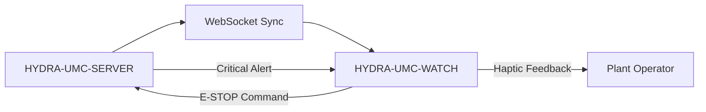

<!-- =============================================================================
HYDRA-UMC-WATCH - Wear OS companion: status cards, haptic alerts and a voice relay
Copyright (C) JuanenRac (Electro Hobby 3D) <electrohobby3d@gmail.com>
GPL-3.0-or-later - see LICENSE
============================================================================= -->

<p align="center">
  
</p>

# ⌚ HYDRA-UMC-WATCH

<p align="center">🇺🇸 <b>English</b> | <a href="README_spa.md">🇪🇸 Español</a> | <a href="README_fra.md">🇫🇷 Français</a> | <a href="README_ita.md">🇮🇹 Italiano</a> | <a href="README_deu.md">🇩🇪 Deutsch</a> | <a href="README_zho.md">🇨🇳 简体中文</a> | <a href="README_jpn.md">🇯🇵 日本語</a> | <a href="README_por.md">🇵🇹 Português</a></p>

### ⌚ Wear OS Companion: Status Cards, Haptic Alerts and a Voice Relay (no wireless E-STOP)

<p align="center">
  
  
  
  
  
  
</p>

---

> **Safety and security status:** this ecosystem is not a certified safety system. There is no hardware E-STOP path, no firmware-enforced limits or interlocks and no verified motion command yet; firmware images are checked with CRC32 and a shared-key HMAC-SHA256, not with an asymmetric signature; TLS and mutual TLS are optional and off by default; no custom board has been populated or tested yet. Read the [security baseline](https://github.com/JuanenRac/HYDRA-UMC-DOCS/blob/main/docs/SECURITY_BASELINE.md) and the [threat model](https://github.com/JuanenRac/HYDRA-UMC-DOCS/blob/main/docs/THREAT_MODEL.md) before relying on any statement here for the safety of a person.

---

## 📋 At a glance

| | |
|---|---|
| Version | `0.2.6` |
| Maturity | Functional |
| Tests | 94 (`./gradlew testDebugUnitTest`) |
| Stack | Kotlin / Wear OS |
| Target | A Wear OS watch (paired with the phone) |
| On real hardware | Not yet: no run on real hardware is recorded for this version |

**Jump to:** [Overview](#-overview) · [Architecture](#-architecture) · [Security & Safety](#-security--safety) · [Quick start](#-quick-start) · [Testing](#-testing) · [Repository Structure](#-repository-structure) · [Related Projects](#-related-projects)

## 🚦 Project status

Each line is one part of this repository and the light says how far it is today. It is written from what the repository can show (tests, builds, runs), not from what is planned.

🟢 Done and verified · 🟡 Works, with known limits · 🟠 Partly done or not verified yet · 🔴 Not done or not working

| Area | State | What it means here |
|---|---|---|
| Software | 🟡 | Works for its main purpose; the honesty check above lists what is still missing |
| Tests | 🟢 | 94 automated tests, run on every change |
| Real hardware | 🔴 | Not yet: no run on real hardware is recorded for this version |
| Documentation | 🟢 | README in eight languages, checked against the manifest on every change |

## 🎯 Overview

**HYDRA-UMC-WATCH** is the wrist companion for the plant operator. It shows glanceable status and alert information on the wrist and relays short voice turns through the paired phone. It is not a safety device: it has no wireless E-STOP, and it has not been run on a physical watch yet.

Built as a standalone Wear OS app (Kotlin + Jetpack Compose for Wear), reusing the same Gradle/Kotlin toolchain as sibling repo HYDRA-UMC-ANDROID-CONTROL rather than introducing a new one.

### Key Features:
* ✅ **Real v0 - haptic patterns & sync protocol:** `haptics/HapticPatterns.kt` defines a real, distinct vibration waveform per alert severity (Critical/Warning/Info); `protocol/SyncMessage.kt` defines and (de)serializes the real `EStopCommand`/`Alert` message shapes for the SERVER<->WATCH sync flow below. Both are plain, testable Kotlin - no watch hardware, emulator, or open WebSocket needed to run or test either.
* 🛑 **Wireless E-STOP (planned)** — dedicated emergency button. *(the `EStopCommand` message it would send is real and tested; the WebSocket transport and physical button wiring are still planned - needs HYDRA-UMC-SERVER pairing.)*
* 📳 **Haptic Alerts** — differentiated vibration patterns for various alert types (Critical, Warning, Info), played through Android's real `Vibrator`/`VibratorManager` service. *(implemented - `haptics/HapticAlertPlayer.kt`; still unverified on a real Wear OS device, same as the rest of this app.)*
* 🎙️ **Voice** — tap-to-talk: explicit `RECORD_AUDIO` permission request, the system speech-recognition intent (`RecognizerIntent`) for transcription, the transcript relayed to HYDRA-UMC-ANDROID-CONTROL as a bounded `voice_turn` sync message, and a local `TextToSpeech` reply on the watch. *(implemented - `MainActivity.kt`; voice can never actuate a robot directly, see Architecture below and [docs/VOICE_AI_PROTOCOL.md](docs/VOICE_AI_PROTOCOL.md) for the full end-to-end message flow and safety boundary.)*
* ⌚ **Glanceable Status** — a **Refresh status** button relays a bounded status request to HYDRA-UMC-ANDROID-CONTROL over the paired Data Layer; the returned `system_status` card is shown with a "last known - may be outdated" indicator once it goes stale. *(implemented - `MainActivity.kt`/`WatchRelayTransport.requestSystemStatus()`; pull-based over the phone relay, not a direct watch-to-server push socket, and still unverified on a real Wear OS device.)*
* 🔐 **JWT Auth** — JWT-based pairing with HYDRA-UMC-SERVER. *(planned.)*
* ✅ **Standalone Wear OS toolchain** — a real Gradle/Kotlin/Compose-for-Wear app that builds a working debug APK. *(implemented — see Build & Release below)*
* 🔁 **Relay Reconnection Policy** — `transport/RelayRetryPolicy.kt` is a real, pure exponential-backoff policy for a failed relay send (e.g. no paired phone yet), capped at a bounded max delay; a pending retry is cancelled outright once the screen closes, never firing against an already-destroyed activity. *(implemented)*
* 🧭 **Companion-verified node selection** — `WatchRelayTransport` sends over a real `CapabilityClient` query (`hydra_umc_phone_companion`, declared in HYDRA-UMC-ANDROID-CONTROL's own `res/values/wear.xml`), never `connectedNodes.firstOrNull()` - a second connected node with no companion app installed can never be picked by accident; a nearby (directly Bluetooth-reachable) node is preferred over a cloud-relayed one when more than one qualifies. *(implemented - `pickCompanionNode()`)*
* 🗂️ **Last-Known-State Cache** — `transport/LastKnownStateCache.kt` tracks real staleness on the last relayed status/alert, so an old one is never shown as current. *(implemented)*
* 📥 **Relay inbox** — `transport/RelayInbox.kt`: on Wear OS the screen is destroyed as soon as the wrist is lowered, and a reply that arrived meanwhile had no receiver and was lost. The listener service now holds the newest messages (at most 8, none older than 10 minutes) and the screen shows them when it is created again, without speaking them or vibrating. *(implemented; not tried on a real watch)*
* 🌐 **8-language UI** — `app/src/main/res/values-xx/strings.xml` for English, Spanish, French, German, Italian, Japanese, Chinese and Portuguese, picked automatically from the watch's system language; `LocalizedStringsTest` checks that every language file has exactly the English keys and format specifiers, so a missing string or a broken placeholder fails the build instead of showing up on the wrist. *(implemented)*

## 🧩 Role in HYDRA-UMC

**HYDRA-UMC-WATCH** is the Wear OS companion of the HYDRA-UMC controller apps: it shows the last known system status with its age, plays a distinct vibration for each alert severity, and relays a voice request through the paired phone. It holds no server credential and offers no wireless emergency stop.

## 🏛️ Architecture

<p align="center">
  
</p>

<details>
<summary>Text version of the diagram (Mermaid)</summary>



</details>

### WEARABLE SYNC FLOW

*Target architecture once a direct Server WebSocket exists. The real, tested
path today relays through the paired phone instead: Watch -> Data Layer ->
HYDRA-UMC-ANDROID-CONTROL -> authenticated HYDRA-UMC-SERVER/Voice UI, and
back - see Architecture below and
[docs/VOICE_AI_PROTOCOL.md](docs/VOICE_AI_PROTOCOL.md) for that real
end-to-end flow. The Watch never holds a Server credential itself; a direct
Watch-to-Server WebSocket and the wireless E-STOP button remain future,
hardware-gated work.*

### ARCHITECTURE & DESIGN DECISIONS

* **Why this is a standalone Wear OS app, not a feature of the phone app.** A watch runs its own independent process on its own OS - it can't just be a UI mode of HYDRA-UMC-ANDROID-CONTROL, it needs its own manifest, its own build, and its own (much more constrained) UI for glanceable status/quick E-STOP.
* **Why `minSdk 30` (Wear OS 3), lower than the phone app's own minSdk.** This targets the current Wear OS 3+ hardware generation deliberately, not old Wear OS 2 devices - unlike HYDRA-UMC-ANDROID-CONTROL, which supports older phones, a companion watch app has a narrower realistic hardware base to support.
* **Why the paired relay uses Data Layer instead of a custom socket.** The official Wear OS channel enforces the same package name and signing certificate on Watch and phone, then carries only bounded protocol messages. Android Control retains the Server session; this keeps the Watch out of direct Server credential and robot-control paths.
* **Why reconnection policy and last-known-state cache are their own pure modules, not inline in `WatchRelayTransport`.** Both are real, decoupled Kotlin classes (`RelayRetryPolicy`, `LastKnownStateCache`) testable on a plain JVM without a watch, emulator, or paired phone - the same standard `HapticPatterns.kt`/`SyncMessage.kt` already set. `WatchRelayTransport` itself stays the thin, necessarily-Android piece that actually schedules a retry or records a received message, not where the underlying policy math lives.
* **Why a stale cached state is flagged, not hidden.** Withholding an old status entirely would leave the watch face blank exactly when the phone connection is flaky - the real risk moment. Showing it clearly marked "last known - may be outdated" keeps the operator informed without letting a minutes-old reading pass as a live one.
* **How this fits the rest of the ecosystem.** Pairs with HYDRA-UMC-ANDROID-CONTROL and HYDRA-UMC-IOS-CONTROL as a glanceable, on-wrist companion - not a replacement for either, a quick-status/quick-E-STOP surface.

### UPDATES WITHOUT GOOGLE PLAY

This project is not distributed through Google Play. The repeatable update
path is a GitHub Release APK installed over ADB:

```bash
# from the project root, watch paired and Wireless debugging enabled
update-from-github.bat    # Windows
./update-from-github.sh   # Linux / macOS / WSL
```

The script reads `releases/latest` from GitHub, requires a stable
`vMAJOR.MINOR.PATCH` tag, checks the version already installed, asks for
explicit operator confirmation, then downloads and runs `adb install -r`. It
never touches the repository version, manifest or `CHANGELOG.md`. A manual,
best-effort install (open the downloaded APK's package installer directly on
the watch) is also documented for devices without a usable ADB path. See
[docs/GITHUB_ADB_UPDATES.md](docs/GITHUB_ADB_UPDATES.md) for the full
procedure, release-APK naming requirement, and release-signing setup.

`HYDRA-UMC-ANDROID-CONTROL` can inform the operator that a newer Watch
release exists once the paired companion-version status message is wired up
— it is informational only and can never install anything on the watch
itself. See [docs/COMPANION_VERSION_PROTOCOL.md](docs/COMPANION_VERSION_PROTOCOL.md)
for that message shape.

## 🔒 Security & Safety

| Threat | Defence | Where |
|---|---|---|
| Another app or a stranger's phone sending messages to the watch | The relay uses the Wear OS Data Layer, which only carries traffic between APKs with the same package name and signing certificate; the target is chosen by a capability query, never by guessing a connected node | `WatchRelayTransport.kt` |
| A stolen or lost watch giving access to the server | The watch never holds a server credential: the paired phone app authenticates and the watch only relays bounded protocol messages | `SyncMessage.kt`, `docs/VOICE_AI_PROTOCOL.md` |
| An action offered while the phone is out of reach, then failing later | Without a recent message from the phone companion an action that goes through it is withheld; a refresh is never gated, since it is how the heartbeat is obtained, and an old status is shown marked as old, not hidden | `CriticalActionGate.kt`, `LastKnownStateCache.kt` |

**What it never does:** act as an emergency stop. A wireless E-STOP button and a direct link to the server are future work that needs hardware.

## 🚀 Quick start

Requires the Android SDK with a JDK that the bundled Gradle wrapper accepts, and a Wear OS 3 or newer watch or emulator.

```bash
./build.sh               # Linux, macOS (build.bat on Windows)
./run.sh                 # installs the debug app on the connected watch and starts it
./update-from-github.sh  # installs the newest release by ADB, without Google Play
```

## 🧪 Testing

94 automated tests run with `./gradlew testDebugUnitTest`. They need no hardware and nothing outside this machine.

The CI runs `HYDRA_UMC_CI=1 python tools/ci_validate.py`, which checks the manifest, the documents, the eight READMEs and the pictures.

## 🏗️ Build & Release

Requires JDK 21, the Android SDK (`local.properties` → `sdk.dir`, gitignored — point it at your own SDK install), and a Wear OS device or emulator for `run`.

```bash
# Linux/macOS
chmod +x gradlew   # one-time
./build.sh
./run.sh            # needs a connected Wear OS device/emulator

# Windows
build.bat
run.bat
```

`build` never changes the version (only `python tools/hydra_project_tool.py bump` raises it), runs the real JUnit test suite (`haptics`, `protocol`, `transport`), and compiles the debug APK to `app/build/outputs/apk/debug/app-debug.apk` - all in one Gradle invocation (the scripts still pass `-PhydraUmcReadOnly=true`, but it has no effect any more: the Gradle build never changes the version). `run` installs the APK via `gradlew installDebug` and launches `MainActivity` with `adb`.

Real example - the two version-bump scripts are run by the explicit bump command and also run standalone (they change the version files when they run):

```bash
python3 bump_manifest_version.py   # e.g. "HYDRA-UMC version: v0.1.2 -> v0.1.3"
python3 bump_version_code.py       # e.g. "versionCode: 12 -> 13"
```

## 📂 Repository Structure

<p align="center">
  
</p>

<details>
<summary>Text version of the tree</summary>

```text
HYDRA-UMC-WATCH/
├── tools/                                source code
│   ├── build_test.py                     Non-mutating CI check: contract verification + assembleDebug
│   ├── ci_validate.py                    Manifest/CHANGELOG/docs validation used by CI
│   ├── verify_paired_relay_contract.py   Static Watch<->Android Control Data Layer safety-boundary check
│   ├── _doc_policy.py                    Documentation rules shared by the family (a copy of HYDRA-UMC-SDK's, kept in sync)
│   ├── _readme_parity.py                 Check that the eight READMEs share one structure (a copy of HYDRA-UMC-SDK's, kept in sync)
│   ├── hydra_project_tool.py             The same commands in every repository: validate, test, ci, version, status, bump
│   └── extra_build_steps.py              The build steps of this repository beyond the shared build test (its own unit tests)
├── app/
├── gradle/
├── docs/                                 Documentation and safety protocols
├── images/                               Media and diagrams
├── .github/                              CI workflow and issue templates
├── build.gradle.kts                      Root Gradle build
├── settings.gradle.kts                   Module wiring
├── gradlew / gradlew.bat                 Gradle wrapper launcher
├── hydra-umc.project.json                Ecosystem manifest (version, build/health metadata)
├── keystore.properties.example           Template for the ignored release-signing config
├── bump_manifest_version.py              Bumps major/minor/patch + the manifest, in lockstep
├── bump_version_code.py                  Android versionCode counter bump (run only by the explicit `bump` command)
├── build.sh / build.bat                  Validate and build (building never changes the version)
├── build-test.sh / build-test.bat        Non-mutating wrapper for tools/build_test.py
├── run.sh / run.bat                      Real run: gradlew installDebug + adb launch
├── CHANGELOG.md                          what changed in each version
├── test.sh                               runs the tests
├── update-from-github.bat                installs the newest release by ADB
└── update-from-github.sh                 installs the newest release by ADB
```

</details>

## 🗺️ Roadmap & Known limits

**Known limits today**

**Real today:** local alert playback through Android's `Vibrator` service, explicit microphone permission and system speech recognition, visible transcript feedback and local text-to-speech, plus tested typed messages for `voice_turn`, `assistant_reply`, `system_status`, `EStopCommand`, `Alert` and companion version status. The official Wear OS Data Layer relays bounded voice turns and status-card requests through HYDRA-UMC-ANDROID-CONTROL to the authenticated Server and Voice UI.

**Integration boundary:** the paired Android app retains the encrypted Server JWT; Server retains the Voice UI token. Data Layer requires the same package name and signing certificate on both APKs. Voice can never actuate a robot directly; a movement-related reply must require confirmation, while the physical E-STOP stays independent.

**Still ahead:** validation of pairing, radio transport, microphone/speaker and end-to-end status on a real Wear OS device; wireless E-STOP and live CM5 telemetry remain separate hardware-gated work.

## 🌍 Languages

This README and the documents of the repository exist in eight languages: English, Spanish, German, French, Italian, Japanese, Chinese and Portuguese (Portugal). They are written together and checked in the CI so that the eight files have the same sections and the same links.

## 🔗 Related Projects

This project is part of the HYDRA-UMC robotics ecosystem by the same author (JuanenRac / Electro Hobby 3D). Worth knowing about, since a request might actually be about one of these rather than this repository.

**Directly Related**
- **[HYDRA-UMC-ANDROID-CONTROL](https://github.com/JuanenRac/HYDRA-UMC-ANDROID-CONTROL)** — native Android control app with biometric login and a paired Wear OS companion — the companion app this wearable pairs with.
- **[HYDRA-UMC-IOS-CONTROL](https://github.com/JuanenRac/HYDRA-UMC-IOS-CONTROL)** — iOS/iPadOS control app (Flutter) with real-time WebSocket sync — the companion app this wearable pairs with.
- **[HYDRA-UMC-VOICE-UI](https://github.com/JuanenRac/HYDRA-UMC-VOICE-UI)** — real voice front-end (VAD + intent parser) with a bounded, confirmation-gated Watch relay — sends the voice_turn messages this wearable surfaces as haptic alerts.

**Also Part of the Ecosystem**

*Core Hardware & Platform*
- **[HYDRA-UMC](https://github.com/JuanenRac/HYDRA-UMC)** — the robot-arm motherboard design: CM5 host + dual-core STM32H745, meant to orchestrate up to 8 tool arms over CAN-OTA/SPI-OTA (firmware at an early stage; no populated board yet).
- **[HYDRA-UMC-OS](https://github.com/JuanenRac/HYDRA-UMC-OS)** — reproducible Raspberry Pi OS product layer for the CM5: read-only agent, validated config/profiles, WiFi first-contact provisioning.
- **[HYDRA-UMC-SDK](https://github.com/JuanenRac/HYDRA-UMC-SDK)** — the shared JSON-Schema contract and software job-gate boundary every bridge validates its commands against (not a certified safety function).
- **[HYDRA-UMC-CONNECTOR-HUB](https://github.com/JuanenRac/HYDRA-UMC-CONNECTOR-HUB)** — declarative adapter-manifest registry and validator for external-machine connectors; extends the SDK's own contract idea to external machines without replacing the industrial-gateway projects.

*Core Backend & Clients*
- **[HYDRA-UMC-SERVER](https://github.com/JuanenRac/HYDRA-UMC-SERVER)** — the real headless backend (REST/WebSocket) every control client actually talks to.
- **[HYDRA-UMC-STUDIO](https://github.com/JuanenRac/HYDRA-UMC-STUDIO)** — web control dashboard with real-time multi-robot 3D visualization.
- **[HYDRA-UMC-SUITE](https://github.com/JuanenRac/HYDRA-UMC-SUITE)** — desktop (PySide6) swarm command center for multiple servers at once, packaged as a standalone executable.
- **[HYDRA-UMC-DSI](https://github.com/JuanenRac/HYDRA-UMC-DSI)** — native touch UI for the onboard 7" DSI touchscreen, embedded on the CM5 itself.
- **[HYDRA-UMC-EDITOR-URDF](https://github.com/JuanenRac/HYDRA-UMC-EDITOR-URDF)** — desktop graphical URDF creator/editor that pushes finished models into STUDIO's own catalog.
- **[HYDRA-UMC-EDITOR-STL](https://github.com/JuanenRac/HYDRA-UMC-EDITOR-STL)** — desktop STL model editor, transforming/replacing/removing/adding real parts in the same model catalog HYDRA-UMC-EDITOR-URDF also edits.
- **[HYDRA-UMC-BRIDGE-AMR](https://github.com/JuanenRac/HYDRA-UMC-BRIDGE-AMR)** — coordination boundary for AGV/AMR fleets via a VDA 5050 MQTT publisher (tested against an emulated fleet only).
- **[HYDRA-UMC-BRIDGE-CNC](https://github.com/JuanenRac/HYDRA-UMC-BRIDGE-CNC)** — high-level CNC-cell coordinator with GRBL status/control-byte access (tested against an emulator only).
- **[HYDRA-UMC-BRIDGE-DROIDS](https://github.com/JuanenRac/HYDRA-UMC-BRIDGE-DROIDS)** — coordination boundary for legged/humanoid droids, with a Boston Dynamics Spot command sender (tested against an emulator only).
- **[HYDRA-UMC-BRIDGE-LASER](https://github.com/JuanenRac/HYDRA-UMC-BRIDGE-LASER)** — laser-cell coordinator reading 3 key/enclosure/interlock GPIO signals (tested against a fake chip only; it cannot arm or fire a laser).
- **[HYDRA-UMC-BRIDGE-OPENPNP](https://github.com/JuanenRac/HYDRA-UMC-BRIDGE-OPENPNP)** — safe high-level board-flow coordinator for OpenPnP pick-and-place.
- **[HYDRA-UMC-BRIDGE-PRINTER3D](https://github.com/JuanenRac/HYDRA-UMC-BRIDGE-PRINTER3D)** — safe coordination boundary for Moonraker/Klipper 3D printers, with real gated job commands.
- **[HYDRA-UMC-BRIDGE-ROS2](https://github.com/JuanenRac/HYDRA-UMC-BRIDGE-ROS2)** — coordinator with a lazily imported rclpy ROS 2 transport (not yet run against a ROS 2 installation).
- **[HYDRA-UMC-BRIDGE-UAV](https://github.com/JuanenRac/HYDRA-UMC-BRIDGE-UAV)** — coordination boundary for camera-equipped UAVs, with a MAVLink command sender (tested against an emulator only).

*URTC Tool Platform*
- **[URTC](https://github.com/JuanenRac/URTC)** — firmware for the physical Universal Robot Tool Controller PCB, 25+ tool profiles over CAN bus.
- **[URTC-FLASHER](https://github.com/JuanenRac/URTC-FLASHER)** — desktop GUI flashing tool for URTC boards, CAN-OTA plus full-chip SWD/JTAG.
- **[URTC-TESTER](https://github.com/JuanenRac/URTC-TESTER)** — desktop live CAN-bus diagnostic tool for URTC boards, one panel per tool profile.
- **[URTC-WEB-STUDIO](https://github.com/JuanenRac/URTC-WEB-STUDIO)** — browser-based alternative to URTC-TESTER via the Web Serial API, no local install needed.
- **[URTC-GATEWAY](https://github.com/JuanenRac/URTC-GATEWAY)** — gateway in front of the URTC CAN bus: an allowed list of identifiers, a rate limit and a session key; software tested on a computer, not yet on a real bus.

*Vision AI Node (Hailo-8)*
- **[HYDRA-UMC-VISION-NODE](https://github.com/JuanenRac/HYDRA-UMC-VISION-NODE)** — integration hub for the Hailo-8 vision pipeline, with a real per-stage hardware-readiness check.
- **[HYDRA-UMC-DETECTION-HEF](https://github.com/JuanenRac/HYDRA-UMC-DETECTION-HEF)** — real compiled-model registry with Hailo-architecture/checksum safe-load verification.
- **[HYDRA-UMC-VISION-STREAMER](https://github.com/JuanenRac/HYDRA-UMC-VISION-STREAMER)** — real GStreamer pipeline + MediaMTX config generator with a real HailoRT integration boundary.
- **[HYDRA-UMC-VISUAL-SERVOING-API](https://github.com/JuanenRac/HYDRA-UMC-VISUAL-SERVOING-API)** — Position-Based Visual Servoing correction law with authorisation gated on the zone state; no camera pose estimation yet.
- **[HYDRA-UMC-SAFETY-ZONES](https://github.com/JuanenRac/HYDRA-UMC-SAFETY-ZONES)** — v0 zone-breach, calibration-freshness and E-STOP-request logic that takes object positions from a file; no detector feeds it and no physical E-STOP is wired to it yet.

*Cognitive AI Node (Hailo-10)*
- **[HYDRA-UMC-COGNITIVE-NODE](https://github.com/JuanenRac/HYDRA-UMC-COGNITIVE-NODE)** — integration hub for the Hailo-10 cognitive pipeline (LLM/VLA/voice orchestration).
- **[HYDRA-UMC-VLA-ENGINE](https://github.com/JuanenRac/HYDRA-UMC-VLA-ENGINE)** — real action-token encoding/decoding and trajectory generation for a Vision-Language-Action model.
- **[HYDRA-UMC-SEMANTIC-PLANNER](https://github.com/JuanenRac/HYDRA-UMC-SEMANTIC-PLANNER)** — real rule-based task decomposition and semantic error recovery over MCU error codes.
- **[HYDRA-UMC-DOCS-QA](https://github.com/JuanenRac/HYDRA-UMC-DOCS-QA)** — real stdlib-only TF-IDF document search over this ecosystem's own Markdown docs.
- **[HYDRA-UMC-LOCAL-TECHNICIAN](https://github.com/JuanenRac/HYDRA-UMC-LOCAL-TECHNICIAN)** — local, policy-gated AI maintenance technician for the ecosystem itself - observes, diagnoses and proposes fixes; the two highest risk levels are deliberately not implemented yet.

*Orchestration & Swarm*
- **[HYDRA-UMC-ORCHESTRATOR](https://github.com/JuanenRac/HYDRA-UMC-ORCHESTRATOR)** — integration hub with a real gRPC/Protobuf health-report contract and mission state machine.
- **[HYDRA-UMC-JOB-DISPATCHER](https://github.com/JuanenRac/HYDRA-UMC-JOB-DISPATCHER)** — real priority-based job queue with deduplication, over a real HTTP API.
- **[HYDRA-UMC-NODE-HEALING](https://github.com/JuanenRac/HYDRA-UMC-NODE-HEALING)** — real gRPC-based fleet health watchdog with retry/backoff and identity-mismatch detection.
- **[HYDRA-UMC-PATH-PLANNER-3D](https://github.com/JuanenRac/HYDRA-UMC-PATH-PLANNER-3D)** — real RRT-based 3D path planner with real obstacle/workspace collision validation.
- **[HYDRA-UMC-SWARM-SYNC](https://github.com/JuanenRac/HYDRA-UMC-SWARM-SYNC)** — real CRDT LWW-Element-Map state sync, property-tested for multi-cell convergence.

*Digital Twin & Simulation*
- **[HYDRA-UMC-TWIN](https://github.com/JuanenRac/HYDRA-UMC-TWIN)** — integration hub for the digital-twin engine, with a real version-compatibility sync contract.
- **[HYDRA-UMC-HIL-BRIDGE](https://github.com/JuanenRac/HYDRA-UMC-HIL-BRIDGE)** — hardware-in-the-loop router with a software collision interlock between simulation and real hardware (tested without real hardware).
- **[HYDRA-UMC-PHYSICS-REPLICA](https://github.com/JuanenRac/HYDRA-UMC-PHYSICS-REPLICA)** — real forward kinematics and joint-limit validation over a real URDF subset.
- **[HYDRA-UMC-SYNTHETIC-DATA-GEN](https://github.com/JuanenRac/HYDRA-UMC-SYNTHETIC-DATA-GEN)** — real procedural 2D scene generator with YOLO/COCO annotation export.

*Data & Analytics*
- **[HYDRA-UMC-DATALAKE](https://github.com/JuanenRac/HYDRA-UMC-DATALAKE)** — real sqlite3-backed time-series store with a real ingest/query HTTP API.
- **[HYDRA-UMC-ANOMALY-DETECTOR](https://github.com/JuanenRac/HYDRA-UMC-ANOMALY-DETECTOR)** — real FFT + statistical baseline anomaly detector with drift monitoring.
- **[HYDRA-UMC-PRODUCTION-REPORTS](https://github.com/JuanenRac/HYDRA-UMC-PRODUCTION-REPORTS)** — real OEE/availability calculation over DATALAKE history, with reproducible CSV export.
- **[HYDRA-UMC-TELEMETRY-COLLECTOR](https://github.com/JuanenRac/HYDRA-UMC-TELEMETRY-COLLECTOR)** — real CAN/WebSocket ingestion pipeline into DATALAKE, with sequence deduplication.

*Industrial Gateway*
- **[HYDRA-UMC-GATEWAY-INDUSTRIAL](https://github.com/JuanenRac/HYDRA-UMC-GATEWAY-INDUSTRIAL)** — integration hub relaying to industrial protocols, with a real command allowlist/backpressure layer.
- **[HYDRA-UMC-OPCUA-SERVER](https://github.com/JuanenRac/HYDRA-UMC-OPCUA-SERVER)** — real OPC-UA address space, verified with a real binary-protocol client session.
- **[HYDRA-UMC-MQTT-BROKER](https://github.com/JuanenRac/HYDRA-UMC-MQTT-BROKER)** — real MQTT broker with optional per-client authentication and topic ACLs.
- **[HYDRA-UMC-MTCONNECT-ADAPTER](https://github.com/JuanenRac/HYDRA-UMC-MTCONNECT-ADAPTER)** — real MTConnect `/probe` and `/current` XML endpoints with degraded-mode output.

*Complementary Tools & Ecosystem Operations*
- **[HYDRA-UMC-DASHBOARD-AI](https://github.com/JuanenRac/HYDRA-UMC-DASHBOARD-AI)** — Smart Summaries and Anomaly Highlighting panels over DATALAKE/ANOMALY-DETECTOR, with an honest statistical fallback.
- **[HYDRA-UMC-TOOL-CLI](https://github.com/JuanenRac/HYDRA-UMC-TOOL-CLI)** — fleet CLI with a real, stable exit-code contract, a genuine live client of HYDRA-UMC-SERVER's own API.
- **[URTC-SMART-RACK](https://github.com/JuanenRac/URTC-SMART-RACK)** — firmware for a board-mounting rack with real tool-ID decoding and Smart Idle pre-heating logic.
- **[URTC-VISION-TOOL](https://github.com/JuanenRac/URTC-VISION-TOOL)** — firmware plus a real Python vision companion for a thermal/RGB inspection tool head.
- **[HYDRA-UMC-UPDATER](https://github.com/JuanenRac/HYDRA-UMC-UPDATER)** — administrative desktop tool that discovers, clones and updates every repo in this ecosystem.
- **[HYDRA-UMC-OS-REBUILDER](https://github.com/JuanenRac/HYDRA-UMC-OS-REBUILDER)** — Windows/Linux desktop tool that builds a ready-to-flash CM5 image pre-loaded with the ecosystem's most current versions, with Raspberry-Pi-Imager-style first-boot Wi-Fi/user/SSH configuration.
- **[HYDRA-UMC-OPS-AGENT](https://github.com/JuanenRac/HYDRA-UMC-OPS-AGENT)** — maintenance-incident coordinator: a low-privilege edge role collects a sanitized inventory/health snapshot, a control-plane role renders it read-only and asks an AI provider to suggest a diagnosis - never applies a patch or deploys anything.
- **[HYDRA-UMC-DEV-SERVER](https://github.com/JuanenRac/HYDRA-UMC-DEV-SERVER)** — reproducible development host (Raspberry Pi 5 / CM5) that stores the ecosystem's source and runs bounded build/test tasks under a durable queue; a dedicated dev role, explicitly not an operational CM5.

## 📚 Documentation

Where to read more:

* [Security baseline of the ecosystem](https://github.com/JuanenRac/HYDRA-UMC-DOCS/blob/main/docs/SECURITY_BASELINE.md)
* [Threat model of the ecosystem](https://github.com/JuanenRac/HYDRA-UMC-DOCS/blob/main/docs/THREAT_MODEL.md)
* [Changelog of this repository](CHANGELOG.md)
* [License of this repository](LICENSE.md)

## 🤝 Contributing & Community

* Before a pull request run `HYDRA_UMC_CI=1 py -3 tools/ci_validate.py` (or `HYDRA_UMC_CI=1 python3 tools/ci_validate.py`): it must print `CI_VALIDATION=PASS`. Do not run `build.sh` or `build.bat` for this check; building is not a check.
* The eight READMEs are written from one source in HYDRA-UMC-DOCS; do not edit them by hand. Change the source and write them again with `tools/make_readmes.py`.
* Do not state in a README what has not run: say "simulated" or "not tried on hardware" where that is the truth.
* See [CONTRIBUTING.md](CONTRIBUTING.md), the [code of conduct](CODE_OF_CONDUCT.md), [SECURITY.md](SECURITY.md) and [SUPPORT.md](SUPPORT.md).

## 👤 AUTHOR

**JuanenRac (Electro Hobby 3D)** · electrohobby3d@gmail.com

## 📜 LICENSE

GPL-3.0-or-later - [LICENSE](LICENSE).
