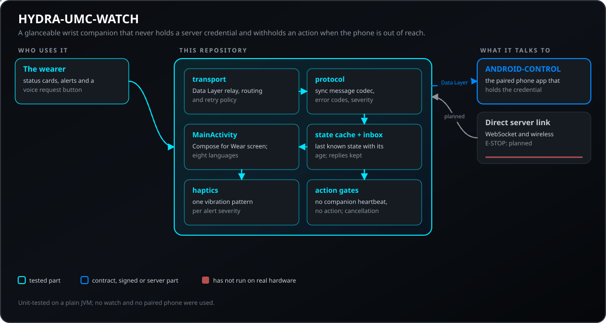
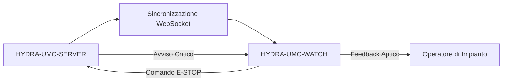
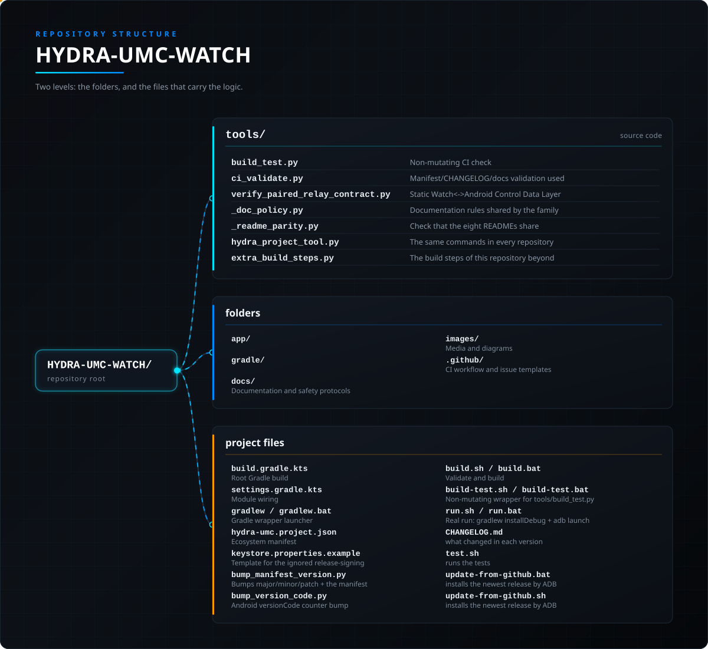

<!-- =============================================================================
HYDRA-UMC-WATCH - Wear OS companion: status cards, haptic alerts and a voice relay
Copyright (C) JuanenRac (Electro Hobby 3D) <electrohobby3d@gmail.com>
GPL-3.0-or-later - see LICENSE
============================================================================= -->

<p align="center">
  
</p>

# ⌚ HYDRA-UMC-WATCH

<p align="center"><a href="README.md">🇺🇸 English</a> | <a href="README_spa.md">🇪🇸 Español</a> | <a href="README_fra.md">🇫🇷 Français</a> | 🇮🇹 <b>Italiano</b> | <a href="README_deu.md">🇩🇪 Deutsch</a> | <a href="README_zho.md">🇨🇳 简体中文</a> | <a href="README_jpn.md">🇯🇵 日本語</a> | <a href="README_por.md">🇵🇹 Português</a></p>

### ⌚ Companion Wear OS: schede di stato, avvisi aptici e relay vocale (nessun E-STOP wireless)

<p align="center">
  
  
  
  
  
  
</p>

---

> **Stato di sicurezza (safety e security):** questo ecosistema non è un sistema di sicurezza certificato. Non esiste ancora un percorso E-STOP hardware, né limiti o interblocchi imposti dal firmware, né un comando di movimento verificato; le immagini firmware sono controllate con CRC-32 e una firma Ed25519, e una compilazione di rilascio rifiuta le chiavi di sviluppo pubblicate (le teste utensile e le schede di espansione dietro il relè usano ancora i bootloader di URTC, che accettano un HMAC-SHA256 a chiave condivisa invece di una firma); TLS e TLS reciproco sono opzionali e disattivati per impostazione predefinita; nessuna scheda propria è stata ancora assemblata o provata. Leggi la [base di sicurezza](https://github.com/JuanenRac/HYDRA-UMC-DOCS/blob/main/docs/SECURITY_BASELINE.md) e il [modello delle minacce](https://github.com/JuanenRac/HYDRA-UMC-DOCS/blob/main/docs/THREAT_MODEL.md) prima di fidarti di qualsiasi affermazione qui per la sicurezza di una persona.

---

## 📋 In breve

| | |
|---|---|
| Versione | `0.2.6` |
| Maturità | Funzionale |
| Test | 94 (`./gradlew testDebugUnitTest`) |
| Tecnologia | Kotlin / Wear OS |
| Destinazione | Un orologio Wear OS (abbinato al telefono) |
| Su hardware reale | Non ancora: per questa versione non risulta alcuna esecuzione su hardware reale |

**Vai a:** [Panoramica](#-panoramica) · [Architettura](#-architettura) · [Sicurezza e protezione](#-sicurezza-e-protezione) · [Avvio rapido](#-avvio-rapido) · [Test](#-test) · [Struttura del repository](#-struttura-del-repository) · [Progetti correlati](#-progetti-correlati)

## 🚦 Stato del progetto

Ogni riga è una parte di questo repository e il semaforo dice a che punto è oggi. È scritta in base a ciò che il repository può mostrare (test, compilazioni, esecuzioni), non a ciò che è previsto.

🟢 Fatto e verificato · 🟡 Funziona, con limiti noti · 🟠 Fatto a metà o non ancora verificato · 🔴 Non fatto o non funzionante

| Area | Stato | Cosa significa qui |
|---|---|---|
| Software | 🟡 | Funziona per il suo scopo principale; la verifica di onestà qui sopra elenca ciò che manca ancora |
| Test | 🟢 | 94 test automatici, eseguiti a ogni modifica |
| Hardware reale | 🔴 | Non ancora: per questa versione non risulta alcuna esecuzione su hardware reale |
| Documentazione | 🟢 | README in otto lingue, verificato rispetto al manifesto a ogni modifica |

## 🎯 Panoramica

**HYDRA-UMC-WATCH** è il compagno da polso per l'operatore d'impianto. Mostra a colpo d'occhio informazioni di stato e avvisi al polso e inoltra brevi turni vocali tramite il telefono abbinato. Non è un dispositivo di sicurezza: non ha un E-STOP wireless e non è ancora stato eseguito su un orologio fisico.

Costruita come app Wear OS autonoma (Kotlin + Jetpack Compose per Wear), riutilizzando la stessa toolchain Gradle/Kotlin del repository gemello HYDRA-UMC-ANDROID-CONTROL invece di introdurne una nuova.

### Caratteristiche Principali:
* ✅ **Reale v0 - pattern aptici e protocollo di sincronizzazione:** `haptics/HapticPatterns.kt` definisce un pattern di vibrazione reale e distinto per severità di avviso (Critico/Avviso/Info); `protocol/SyncMessage.kt` definisce e (de)serializza le forme reali dei messaggi `EStopCommand`/`Alert` del flusso di sincronizzazione SERVER<->WATCH sotto. Entrambi sono Kotlin puro, testabile - non serve hardware da orologio, emulatore, né un WebSocket aperto per eseguirli o testarli.
* 🛑 **E-STOP Wireless (pianificato)** — pulsante di emergenza dedicato. *(il messaggio `EStopCommand` che invierebbe è reale e testato; il trasporto WebSocket e il collegamento del pulsante fisico restano pianificati — richiede l'accoppiamento con HYDRA-UMC-SERVER.)*
* 📳 **Avvisi Aptici** — pattern di vibrazione differenziati per i vari tipi di avviso (Critico, Avviso, Info), riprodotti tramite il vero servizio Android `Vibrator`/`VibratorManager`. *(implementato - `haptics/HapticAlertPlayer.kt`; ancora non verificato su un vero dispositivo Wear OS, come il resto di questa app.)*
* 🎙️ **Voce** — tocca per parlare: richiesta esplicita del permesso `RECORD_AUDIO`, l'intent di riconoscimento vocale di sistema (`RecognizerIntent`) per la trascrizione, la trascrizione inoltrata a HYDRA-UMC-ANDROID-CONTROL come messaggio di sync `voice_turn` limitato, e una risposta locale tramite `TextToSpeech` sull'orologio. *(implementato - `MainActivity.kt`; la voce non può mai azionare direttamente un robot, vedi Architettura sotto e [docs/VOICE_AI_PROTOCOL.md](docs/VOICE_AI_PROTOCOL.md) per il flusso completo end-to-end e il limite di sicurezza.)*
* ⌚ **Stato a Colpo d'Occhio** — un pulsante **Aggiorna stato** inoltra una richiesta di stato limitata a HYDRA-UMC-ANDROID-CONTROL tramite il Data Layer accoppiato; la card `system_status` ricevuta viene mostrata con un indicatore "ultimo noto - potrebbe essere obsoleto" non appena diventa obsoleta. *(implementato - `MainActivity.kt`/`WatchRelayTransport.requestSystemStatus()`; su richiesta tramite il relay del telefono, non un socket diretto orologio-server, e ancora non verificato su un vero dispositivo Wear OS.)*
* 🔐 **JWT Auth** — accoppiamento basato su JWT con HYDRA-UMC-SERVER. *(pianificato.)*
* ✅ **Toolchain Wear OS autonoma** — una vera app Gradle/Kotlin/Compose per Wear che compila un APK di debug funzionante. *(implementato — vedi COMPILAZIONE ED ESECUZIONE sotto)*
* 🔁 **Politica di Riconnessione del Relay** — `transport/RelayRetryPolicy.kt` è una politica reale e pura di backoff esponenziale per un invio relay fallito (ad es. nessun telefono ancora accoppiato), limitata a un ritardo massimo definito; un ritentativo pendente viene annullato non appena la schermata si chiude, senza mai scattare contro un'activity già distrutta. *(implementato)*
* 🧭 **Selezione del nodo verificata dal companion** — `WatchRelayTransport` invia tramite una vera query `CapabilityClient` (`hydra_umc_phone_companion`, dichiarata nel proprio `res/values/wear.xml` di HYDRA-UMC-ANDROID-CONTROL), mai `connectedNodes.firstOrNull()` - un secondo nodo connesso senza l'app companion installata non può mai essere scelto per errore; un nodo vicino (raggiungibile direttamente via Bluetooth) è preferito a uno inoltrato tramite cloud quando più di uno è valido. *(implementato - `pickCompanionNode()`)*
* 🗂️ **Cache dell'Ultimo Stato Noto** — `transport/LastKnownStateCache.kt` tiene traccia dell'obsolescenza reale dell'ultimo stato/avviso inoltrato, così uno vecchio non viene mai mostrato come attuale. *(implementato)*
* 📥 **Casella del relè** — `transport/RelayInbox.kt`: su Wear OS lo schermo viene distrutto appena si abbassa il polso, e una risposta arrivata nel frattempo non aveva un ricevitore e andava persa. Il servizio di ascolto ora conserva i messaggi più recenti (al massimo 8, nessuno più vecchio di 10 minuti) e lo schermo li mostra quando viene ricreato, senza pronunciarli né vibrare. *(implementato; non provato su un vero orologio)*
* 🌐 **Interfaccia in 8 lingue** — `app/src/main/res/values-xx/strings.xml` per inglese, spagnolo, francese, tedesco, italiano, giapponese, cinese e portoghese, scelto automaticamente in base alla lingua di sistema dell'orologio; `LocalizedStringsTest` verifica che ogni file di lingua abbia esattamente le chiavi e gli specificatori di formato dell'inglese, così una stringa mancante o un segnaposto rotto fa fallire la compilazione invece di comparire al polso. *(implementato)*

## 🧩 Ruolo in HYDRA-UMC

**HYDRA-UMC-WATCH** è il compagno Wear OS delle app di controllo HYDRA-UMC: mostra l'ultimo stato noto del sistema con la sua età, riproduce una vibrazione distinta per ogni gravità di allarme e inoltra una richiesta vocale tramite il telefono abbinato. Non conserva alcuna credenziale del server e non offre un arresto di emergenza wireless.

## 🏛️ Architettura

<p align="center">
  
</p>

<details>
<summary>Versione testuale del diagramma (Mermaid)</summary>



</details>

### FLUSSO DI SINCRONIZZAZIONE DEL WEARABLE

*Architettura obiettivo una volta che esisterà un WebSocket diretto con il
Server. Il percorso reale e testato oggi passa dal telefono accoppiato:
Watch -> Data Layer -> HYDRA-UMC-ANDROID-CONTROL -> HYDRA-UMC-SERVER/Voice
UI autenticato, e ritorno - vedi Architettura sotto e
[docs/VOICE_AI_PROTOCOL.md](docs/VOICE_AI_PROTOCOL.md) per quel flusso
reale end-to-end. L'orologio non detiene mai da sé una credenziale del
Server; un WebSocket diretto Watch-Server e il pulsante E-STOP wireless
restano lavoro futuro condizionato all'hardware.*

### ARCHITETTURA E DECISIONI DI PROGETTAZIONE

* **Perché è un'app Wear OS autonoma, non una funzionalità dell'app telefono.** Un orologio esegue il proprio processo indipendente sul proprio sistema operativo - non può essere semplicemente una modalità UI di HYDRA-UMC-ANDROID-CONTROL, ha bisogno del proprio manifest, della propria build, e della propria UI (molto più limitata) per stato a colpo d'occhio/E-STOP rapido.
* **Perché `minSdk 30` (Wear OS 3), inferiore al minSdk proprio dell'app telefono.** Questo mira deliberatamente all'attuale generazione hardware Wear OS 3+, non ai vecchi dispositivi Wear OS 2 - a differenza di HYDRA-UMC-ANDROID-CONTROL, che supporta telefoni più vecchi, un'app orologio companion ha una base hardware realistica da supportare molto più ristretta.
* **Perché i pattern aptici e il protocollo di sincronizzazione arrivano prima della connessione WebSocket.** Definire le forme d'onda di vibrazione e le forme dei messaggi su cui entrambe le parti devono concordare è vero lavoro in Kotlin puro - non serve un socket aperto, un server accoppiato o un orologio fisico per scriverlo o testarlo. Aprire davvero quella connessione è il prossimo passo.
* **Perché la politica di riconnessione e la cache dell'ultimo stato noto sono moduli puri a sé stanti, non codice inline in `WatchRelayTransport`.** Entrambe sono classi Kotlin reali e disaccoppiate (`RelayRetryPolicy`, `LastKnownStateCache`) testabili su una semplice JVM senza orologio, emulatore o telefono accoppiato - lo stesso standard già stabilito da `HapticPatterns.kt`/`SyncMessage.kt`. `WatchRelayTransport` stesso resta il pezzo sottile, necessariamente Android, che effettivamente pianifica un nuovo tentativo o registra un messaggio ricevuto, non il luogo dove risiede la logica matematica della policy sottostante.
* **Perché uno stato in cache obsoleto viene segnalato, non nascosto.** Nascondere del tutto uno stato vecchio lascerebbe il quadrante dell'orologio vuoto proprio quando la connessione al telefono è instabile - il vero momento di rischio. Mostrarlo chiaramente contrassegnato come "ultimo noto - potrebbe essere obsoleto" mantiene l'operatore informato senza far passare una lettura vecchia di minuti come se fosse in tempo reale.
* **Come si inserisce nel resto dell'ecosistema.** Si accoppia con HYDRA-UMC-ANDROID-CONTROL e HYDRA-UMC-IOS-CONTROL come companion al polso, a colpo d'occhio - non un sostituto di nessuno dei due, una superficie di stato rapido/E-STOP rapido.

### AGGIORNAMENTI SENZA GOOGLE PLAY

Questo progetto non è distribuito tramite Google Play. Il percorso di
aggiornamento ripetibile è un APK di GitHub Release installato via ADB:

```bash
# dalla radice del progetto, con l'orologio accoppiato e Wireless debugging attivo
update-from-github.bat    # Windows
./update-from-github.sh   # Linux / macOS / WSL
```

Lo script legge `releases/latest` da GitHub, richiede un tag stabile
`vMAJOR.MINOR.PATCH`, controlla la versione già installata, chiede una
conferma esplicita dell'operatore, quindi scarica ed esegue
`adb install -r`. Non tocca mai la versione del repository, il manifest o
`CHANGELOG.md`. È documentata anche un'installazione manuale, a
miglior sforzo (aprire l'APK scaricato con l'installatore di pacchetti
direttamente sull'orologio) per i dispositivi senza un percorso ADB
utilizzabile. Vedi [docs/GITHUB_ADB_UPDATES.md](docs/GITHUB_ADB_UPDATES.md)
per la procedura completa, il nome richiesto per l'APK di release, e la
configurazione della firma di release.

`HYDRA-UMC-ANDROID-CONTROL` può informare l'operatore che esiste una nuova
release dell'orologio una volta collegato il messaggio di stato versione
companion — è puramente informativo e non può mai installare nulla
sull'orologio stesso. Vedi
[docs/COMPANION_VERSION_PROTOCOL.md](docs/COMPANION_VERSION_PROTOCOL.md)
per quella forma di messaggio.

## 🔒 Sicurezza e protezione

| Minaccia | Difesa | Dove |
|---|---|---|
| Un'altra app o il telefono di uno sconosciuto che invia messaggi all'orologio | Il relay usa il Data Layer di Wear OS, che trasporta solo traffico tra APK con lo stesso nome di pacchetto e certificato di firma; la destinazione si sceglie con una query di capacità, mai indovinando un nodo connesso | `WatchRelayTransport.kt` |
| Un orologio rubato o perso che dà accesso al server | L'orologio non conserva mai una credenziale del server: l'app del telefono abbinato si autentica e l'orologio inoltra solo messaggi di protocollo limitati | `SyncMessage.kt`, `docs/VOICE_AI_PROTOCOL.md` |
| Un'azione offerta mentre il telefono è fuori portata, che poi fallisce | Senza un messaggio recente dal telefono compagno un'azione che passa da esso viene trattenuta; un aggiornamento non è mai bloccato, perché è così che si ottiene il segnale di vita, e uno stato vecchio è mostrato come vecchio, non nascosto | `CriticalActionGate.kt`, `LastKnownStateCache.kt` |

**Cosa non fa mai:** fare da arresto di emergenza. Un pulsante di arresto di emergenza wireless e un collegamento diretto al server sono lavoro futuro che richiede hardware.

## 🚀 Avvio rapido

Richiede l'SDK Android con un JDK accettato dal wrapper Gradle incluso, e un orologio o emulatore con Wear OS 3 o successivo.

```bash
./build.sh               # Linux, macOS (build.bat on Windows)
./run.sh                 # installs the debug app on the connected watch and starts it
./update-from-github.sh  # installs the newest release by ADB, without Google Play
```

## 🧪 Test

94 test automatici si eseguono con `./gradlew testDebugUnitTest`. Non richiedono hardware né nulla al di fuori di questa macchina.

La CI esegue `HYDRA_UMC_CI=1 python tools/ci_validate.py`, che controlla il manifesto, i documenti, gli otto README e le immagini.

## 🏗️ Compilazione e rilascio

Richiede JDK 21, l'Android SDK (`local.properties` → `sdk.dir`, ignorato da git — puntalo alla tua installazione locale dell'SDK) e un dispositivo o emulatore Wear OS per `run`.

```bash
# Linux/macOS
chmod +x gradlew   # una tantum
./build.sh
./run.sh            # richiede un dispositivo/emulatore Wear OS connesso

# Windows
build.bat
run.bat
```

`build` non cambia mai la versione (solo `python tools/hydra_project_tool.py bump` la aumenta), esegue la vera suite di test JUnit (`haptics`, `protocol`, `transport`), e compila l'APK di debug in `app/build/outputs/apk/debug/app-debug.apk` - tutto in un'unica invocazione Gradle (gli script passano ancora `-PhydraUmcReadOnly=true`, ma non ha più effetto: la build Gradle non cambia mai la versione). `run` installa l'APK tramite `gradlew installDebug` e avvia `MainActivity` con `adb`.

Esempio reale - i due script di incremento versione sono eseguiti dal comando `bump` esplicito e funzionano anche in modo autonomo (modificano i file di versione quando girano):

```bash
python3 bump_manifest_version.py   # es. "HYDRA-UMC version: v0.1.2 -> v0.1.3"
python3 bump_version_code.py       # es. "versionCode: 12 -> 13"
```

## 📂 Struttura del repository

<p align="center">
  
</p>

<details>
<summary>Versione testuale dell'albero</summary>

```text
HYDRA-UMC-WATCH/
├── tools/                                codice sorgente
│   ├── build_test.py                     Verifica CI senza mutazioni: verifica del contratto + assembleDebug
│   ├── ci_validate.py                    Validazione manifest/CHANGELOG/docs usata dalla CI
│   ├── verify_paired_relay_contract.py   Verifica statica del limite di sicurezza Data Layer Watch<->Android Control
│   ├── _doc_policy.py                    Regole di documentazione condivise dalla famiglia (copia di quella di HYDRA-UMC-SDK, mantenuta sincronizzata)
│   ├── _readme_parity.py                 Verifica che gli otto README abbiano la stessa struttura (copia di quella di HYDRA-UMC-SDK, mantenuta sincronizzata)
│   ├── hydra_project_tool.py             Gli stessi comandi in ogni repository: validate, test, ci, version, status, bump
│   └── extra_build_steps.py              I passi di compilazione propri di questo repository oltre al test di compilazione condiviso (i suoi unit test)
├── app/
├── gradle/
├── docs/                                 Documentazione e protocolli di sicurezza
├── images/                               Media e diagrammi
├── .github/                              workflow di CI e modelli di segnalazione
├── build.gradle.kts                      Build radice di Gradle
├── settings.gradle.kts                   Cablaggio dei moduli
├── gradlew / gradlew.bat                 Launcher del Gradle wrapper
├── hydra-umc.project.json                Manifest dell'ecosistema (versione, metadati build/salute)
├── keystore.properties.example           Modello per la config di firma release ignorata da git
├── bump_manifest_version.py              Incrementa major/minor/patch + il manifest, insieme
├── bump_version_code.py                  Incremento del contatore versionCode di Android (eseguito solo dal comando `bump` esplicito)
├── build.sh / build.bat                  Build reale: esegue i test, assembleDebug
├── build-test.sh / build-test.bat        Wrapper senza mutazioni per tools/build_test.py
├── run.sh / run.bat                      Esecuzione reale: gradlew installDebug + avvio adb
├── CHANGELOG.md                          cosa è cambiato in ogni versione
├── test.sh                               esegue i test
├── update-from-github.bat                installa l'ultima versione tramite ADB
└── update-from-github.sh                 installa l'ultima versione tramite ADB
```

</details>

## 🗺️ Roadmap e limiti noti

**Limiti noti oggi**

**Reale oggi:** riproduzione locale degli avvisi tramite il servizio Android `Vibrator`, autorizzazione esplicita del microfono e riconoscimento vocale di sistema, trascrizione visibile e sintesi vocale locale; inoltre messaggi tipizzati e testati per `voice_turn`, `assistant_reply`, `system_status`, `EStopCommand`, `Alert` e stato versione del companion. Il trasporto ufficiale Wear OS Data Layer inoltra turni vocali limitati e richieste di stato tramite HYDRA-UMC-ANDROID-CONTROL al Server autenticato e a Voice UI.

**Limite d'integrazione:** l'app Android associata conserva il JWT cifrato del Server; Server conserva il token Voice UI. Data Layer richiede lo stesso nome pacchetto e certificato di firma nelle due APK. La voce non può mai azionare direttamente un robot; una risposta relativa al movimento deve richiedere conferma e l'E-STOP fisico rimane indipendente.

**Da completare:** convalida di associazione, trasporto radio, microfono/altoparlante e stato end-to-end su un dispositivo Wear OS reale; E-STOP wireless e telemetria CM5 in tempo reale restano lavori separati vincolati all'hardware.

## 🌍 Lingue

Questo README e i documenti del repository esistono in otto lingue: inglese, spagnolo, tedesco, francese, italiano, giapponese, cinese e portoghese (Portogallo). Sono scritti insieme e la CI verifica che gli otto file abbiano le stesse sezioni e gli stessi link.

## 🔗 Progetti correlati

Questo progetto fa parte dell'ecosistema robotico HYDRA-UMC dello stesso autore (JuanenRac / Electro Hobby 3D). Vale la pena conoscerlo, poiché una richiesta potrebbe in realtà riguardare uno di questi invece di questo repository.

**Direttamente Correlati**
- **[HYDRA-UMC-ANDROID-CONTROL](https://github.com/JuanenRac/HYDRA-UMC-ANDROID-CONTROL)** — app di controllo nativa per Android con login biometrico e un companion Wear OS abbinato — l'app companion con cui si abbina questo dispositivo indossabile.
- **[HYDRA-UMC-IOS-CONTROL](https://github.com/JuanenRac/HYDRA-UMC-IOS-CONTROL)** — app di controllo per iOS/iPadOS (Flutter) con sincronizzazione WebSocket in tempo reale — l'app companion con cui si abbina questo dispositivo indossabile.
- **[HYDRA-UMC-VOICE-UI](https://github.com/JuanenRac/HYDRA-UMC-VOICE-UI)** — vero front-end vocale (VAD + parser di intenti) con un relay verso Watch limitato e soggetto a conferma — invia i messaggi voice_turn che questo dispositivo indossabile mostra come avvisi aptici.

**Fa Anche Parte dell'Ecosistema**

*Hardware e Piattaforma di Base*
- **[HYDRA-UMC](https://github.com/JuanenRac/HYDRA-UMC)** — il progetto della scheda madre del braccio robotico: host CM5 + coprocessore STM32H745 dual-core, pensato per coordinare fino a 8 bracci utensile via CAN-OTA/SPI-OTA (firmware in fase iniziale; nessuna scheda assemblata per ora).
- **[HYDRA-UMC-OS](https://github.com/JuanenRac/HYDRA-UMC-OS)** — livello prodotto riproducibile su Raspberry Pi OS per il CM5: agente in sola lettura, config/profili validati, provisioning WiFi al primo contatto.
- **[HYDRA-UMC-SDK](https://github.com/JuanenRac/HYDRA-UMC-SDK)** — il contratto JSON-Schema condiviso e la barriera software di controllo dei job contro cui ogni bridge valida i propri comandi (non è una funzione di sicurezza certificata).
- **[HYDRA-UMC-CONNECTOR-HUB](https://github.com/JuanenRac/HYDRA-UMC-CONNECTOR-HUB)** — registro dichiarativo e validatore di manifesti adattatore per connettori di macchine esterne; estende la propria idea di contratto dell'SDK alle macchine esterne senza sostituire i progetti di gateway industriale.

*Backend Centrale e Client*
- **[HYDRA-UMC-SERVER](https://github.com/JuanenRac/HYDRA-UMC-SERVER)** — il vero backend headless (REST/WebSocket) con cui parla davvero ogni client di controllo.
- **[HYDRA-UMC-STUDIO](https://github.com/JuanenRac/HYDRA-UMC-STUDIO)** — dashboard di controllo web con visualizzazione 3D multi-robot in tempo reale.
- **[HYDRA-UMC-SUITE](https://github.com/JuanenRac/HYDRA-UMC-SUITE)** — centro di comando sciame desktop (PySide6) per più server contemporaneamente, pacchettizzato come eseguibile standalone.
- **[HYDRA-UMC-DSI](https://github.com/JuanenRac/HYDRA-UMC-DSI)** — interfaccia touch nativa per il touchscreen DSI da 7" a bordo, incorporata direttamente nel CM5.
- **[HYDRA-UMC-EDITOR-URDF](https://github.com/JuanenRac/HYDRA-UMC-EDITOR-URDF)** — creatore/editor grafico desktop di URDF che invia i modelli finiti al catalogo di STUDIO.
- **[HYDRA-UMC-EDITOR-STL](https://github.com/JuanenRac/HYDRA-UMC-EDITOR-STL)** — editor desktop di modelli STL, che trasforma/sostituisce/rimuove/aggiunge veri pezzi nello stesso catalogo di modelli modificato anche da HYDRA-UMC-EDITOR-URDF.
- **[HYDRA-UMC-BRIDGE-AMR](https://github.com/JuanenRac/HYDRA-UMC-BRIDGE-AMR)** — barriera di coordinamento per flotte AGV/AMR tramite un publisher MQTT VDA 5050 (testato solo contro una flotta emulata).
- **[HYDRA-UMC-BRIDGE-CNC](https://github.com/JuanenRac/HYDRA-UMC-BRIDGE-CNC)** — coordinatore ad alto livello per celle CNC con accesso a stato/byte di controllo GRBL (testato solo contro un emulatore).
- **[HYDRA-UMC-BRIDGE-DROIDS](https://github.com/JuanenRac/HYDRA-UMC-BRIDGE-DROIDS)** — barriera di coordinamento per droidi con zampe/umanoidi, con un mittente di comandi per Boston Dynamics Spot (testato solo contro un emulatore).
- **[HYDRA-UMC-BRIDGE-LASER](https://github.com/JuanenRac/HYDRA-UMC-BRIDGE-LASER)** — coordinatore per celle laser che legge 3 segnali GPIO di chiave/involucro/interblocco (testato solo contro un chip simulato; non può armare né far partire un laser).
- **[HYDRA-UMC-BRIDGE-OPENPNP](https://github.com/JuanenRac/HYDRA-UMC-BRIDGE-OPENPNP)** — coordinatore ad alto livello sicuro per il flusso schede del pick-and-place OpenPnP.
- **[HYDRA-UMC-BRIDGE-PRINTER3D](https://github.com/JuanenRac/HYDRA-UMC-BRIDGE-PRINTER3D)** — barriera di coordinamento sicura per stampanti 3D Moonraker/Klipper, con comandi di lavoro reali e controllati.
- **[HYDRA-UMC-BRIDGE-ROS2](https://github.com/JuanenRac/HYDRA-UMC-BRIDGE-ROS2)** — coordinatore con un trasporto ROS 2 rclpy importato in modo lazy (non ancora eseguito contro un'installazione ROS 2).
- **[HYDRA-UMC-BRIDGE-UAV](https://github.com/JuanenRac/HYDRA-UMC-BRIDGE-UAV)** — barriera di coordinamento per UAV dotati di fotocamera, con un mittente di comandi MAVLink (testato solo contro un emulatore).

*Piattaforma Strumenti URTC*
- **[URTC](https://github.com/JuanenRac/URTC)** — firmware per la scheda fisica dell'Universal Robot Tool Controller, oltre 25 profili utensile su bus CAN.
- **[URTC-FLASHER](https://github.com/JuanenRac/URTC-FLASHER)** — strumento desktop con GUI per il flashing delle schede URTC, CAN-OTA più SWD/JTAG a chip intero.
- **[URTC-TESTER](https://github.com/JuanenRac/URTC-TESTER)** — strumento desktop di diagnostica CAN-bus dal vivo per schede URTC, un pannello per profilo utensile.
- **[URTC-WEB-STUDIO](https://github.com/JuanenRac/URTC-WEB-STUDIO)** — alternativa basata su browser a URTC-TESTER tramite la Web Serial API, senza installazione locale.
- **[URTC-GATEWAY](https://github.com/JuanenRac/URTC-GATEWAY)** — gateway davanti al bus CAN di URTC: elenco di identificatori consentiti, limite di frequenza e chiave di sessione; software provato su computer, non ancora su un bus reale.

*Nodo IA Visione (Hailo-8)*
- **[HYDRA-UMC-VISION-NODE](https://github.com/JuanenRac/HYDRA-UMC-VISION-NODE)** — hub di integrazione per la pipeline di visione Hailo-8, con un vero controllo di prontezza hardware per fase.
- **[HYDRA-UMC-DETECTION-HEF](https://github.com/JuanenRac/HYDRA-UMC-DETECTION-HEF)** — registro reale di modelli compilati con verifica di caricamento sicuro per architettura Hailo/checksum.
- **[HYDRA-UMC-VISION-STREAMER](https://github.com/JuanenRac/HYDRA-UMC-VISION-STREAMER)** — generatore reale di pipeline GStreamer + config MediaMTX, con una vera barriera di integrazione HailoRT.
- **[HYDRA-UMC-VISUAL-SERVOING-API](https://github.com/JuanenRac/HYDRA-UMC-VISUAL-SERVOING-API)** — legge di correzione Position-Based Visual Servoing con autorizzazione condizionata allo stato di zona; ancora nessuna stima di posa da telecamera.
- **[HYDRA-UMC-SAFETY-ZONES](https://github.com/JuanenRac/HYDRA-UMC-SAFETY-ZONES)** — logica v0 di violazione zona, freschezza di calibrazione e richiesta E-STOP che legge le posizioni degli oggetti da un file; nessun rilevatore la alimenta e nessun E-STOP fisico è ancora collegato.

*Nodo IA Cognitivo (Hailo-10)*
- **[HYDRA-UMC-COGNITIVE-NODE](https://github.com/JuanenRac/HYDRA-UMC-COGNITIVE-NODE)** — hub di integrazione per la pipeline cognitiva Hailo-10 (orchestrazione LLM/VLA/voce).
- **[HYDRA-UMC-VLA-ENGINE](https://github.com/JuanenRac/HYDRA-UMC-VLA-ENGINE)** — vera codifica/decodifica di token d'azione e generazione di traiettoria per un modello Vision-Language-Action.
- **[HYDRA-UMC-SEMANTIC-PLANNER](https://github.com/JuanenRac/HYDRA-UMC-SEMANTIC-PLANNER)** — vera scomposizione dei task basata su regole e recupero semantico degli errori sui codici errore MCU.
- **[HYDRA-UMC-DOCS-QA](https://github.com/JuanenRac/HYDRA-UMC-DOCS-QA)** — vera ricerca documentale TF-IDF (solo libreria standard) sui documenti Markdown di questo ecosistema.
- **[HYDRA-UMC-LOCAL-TECHNICIAN](https://github.com/JuanenRac/HYDRA-UMC-LOCAL-TECHNICIAN)** — tecnico di manutenzione IA locale e con cancelli di policy per l'ecosistema stesso - osserva, diagnostica e propone correzioni; i due livelli di rischio più alti non sono deliberatamente ancora implementati.

*Orchestrazione e Sciame*
- **[HYDRA-UMC-ORCHESTRATOR](https://github.com/JuanenRac/HYDRA-UMC-ORCHESTRATOR)** — hub di integrazione con un vero contratto di health-report gRPC/Protobuf e una macchina a stati di missione.
- **[HYDRA-UMC-JOB-DISPATCHER](https://github.com/JuanenRac/HYDRA-UMC-JOB-DISPATCHER)** — vera coda di lavori basata su priorità con deduplicazione, su una vera API HTTP.
- **[HYDRA-UMC-NODE-HEALING](https://github.com/JuanenRac/HYDRA-UMC-NODE-HEALING)** — vero watchdog di salute della flotta basato su gRPC, con retry/backoff e rilevamento di discrepanza d'identità.
- **[HYDRA-UMC-PATH-PLANNER-3D](https://github.com/JuanenRac/HYDRA-UMC-PATH-PLANNER-3D)** — vero pianificatore di percorsi 3D basato su RRT, con vera validazione delle collisioni ostacolo/spazio di lavoro.
- **[HYDRA-UMC-SWARM-SYNC](https://github.com/JuanenRac/HYDRA-UMC-SWARM-SYNC)** — vera sincronizzazione di stato CRDT LWW-Element-Map, con property test per la convergenza multi-cella.

*Gemello Digitale e Simulazione*
- **[HYDRA-UMC-TWIN](https://github.com/JuanenRac/HYDRA-UMC-TWIN)** — hub di integrazione per il motore di gemello digitale, con un vero contratto di sincronizzazione per compatibilità di versione.
- **[HYDRA-UMC-HIL-BRIDGE](https://github.com/JuanenRac/HYDRA-UMC-HIL-BRIDGE)** — router hardware-in-the-loop con un interblocco software di collisione tra simulazione e hardware reale (testato senza hardware reale).
- **[HYDRA-UMC-PHYSICS-REPLICA](https://github.com/JuanenRac/HYDRA-UMC-PHYSICS-REPLICA)** — vera cinematica diretta e validazione dei limiti articolari su un vero sottoinsieme URDF.
- **[HYDRA-UMC-SYNTHETIC-DATA-GEN](https://github.com/JuanenRac/HYDRA-UMC-SYNTHETIC-DATA-GEN)** — vero generatore procedurale di scene 2D con esportazione di annotazioni YOLO/COCO.

*Dati e Analisi*
- **[HYDRA-UMC-DATALAKE](https://github.com/JuanenRac/HYDRA-UMC-DATALAKE)** — vero archivio di serie temporali basato su sqlite3, con una vera API HTTP di ingestione/query.
- **[HYDRA-UMC-ANOMALY-DETECTOR](https://github.com/JuanenRac/HYDRA-UMC-ANOMALY-DETECTOR)** — vero rilevatore di anomalie FFT + baseline statistica, con monitoraggio della deriva.
- **[HYDRA-UMC-PRODUCTION-REPORTS](https://github.com/JuanenRac/HYDRA-UMC-PRODUCTION-REPORTS)** — vero calcolo OEE/disponibilità sullo storico di DATALAKE, con esportazione CSV riproducibile.
- **[HYDRA-UMC-TELEMETRY-COLLECTOR](https://github.com/JuanenRac/HYDRA-UMC-TELEMETRY-COLLECTOR)** — vera pipeline di ingestione CAN/WebSocket verso DATALAKE, con deduplicazione per sequenza.

*Gateway Industriale*
- **[HYDRA-UMC-GATEWAY-INDUSTRIAL](https://github.com/JuanenRac/HYDRA-UMC-GATEWAY-INDUSTRIAL)** — hub di integrazione che inoltra ai protocolli industriali, con un vero livello di allowlist dei comandi/backpressure.
- **[HYDRA-UMC-OPCUA-SERVER](https://github.com/JuanenRac/HYDRA-UMC-OPCUA-SERVER)** — vero spazio di indirizzi OPC-UA, verificato con una vera sessione client del protocollo binario.
- **[HYDRA-UMC-MQTT-BROKER](https://github.com/JuanenRac/HYDRA-UMC-MQTT-BROKER)** — vero broker MQTT con autenticazione opzionale per client e ACL sui topic.
- **[HYDRA-UMC-MTCONNECT-ADAPTER](https://github.com/JuanenRac/HYDRA-UMC-MTCONNECT-ADAPTER)** — veri endpoint XML `/probe` e `/current` di MTConnect, con output in modalità degradata.

*Strumenti Complementari e Operazioni dell'Ecosistema*
- **[HYDRA-UMC-DASHBOARD-AI](https://github.com/JuanenRac/HYDRA-UMC-DASHBOARD-AI)** — pannelli Smart Summaries e Anomaly Highlighting su DATALAKE/ANOMALY-DETECTOR, con un fallback statistico onesto.
- **[HYDRA-UMC-TOOL-CLI](https://github.com/JuanenRac/HYDRA-UMC-TOOL-CLI)** — CLI di flotta con un vero e stabile contratto di exit-code, un client live reale della stessa API di HYDRA-UMC-SERVER.
- **[URTC-SMART-RACK](https://github.com/JuanenRac/URTC-SMART-RACK)** — firmware per un rack di montaggio schede con decodifica reale dell'ID utensile e logica di preriscaldamento Smart Idle.
- **[URTC-VISION-TOOL](https://github.com/JuanenRac/URTC-VISION-TOOL)** — firmware più un vero companion di visione Python per una testa utensile di ispezione termica/RGB.
- **[HYDRA-UMC-UPDATER](https://github.com/JuanenRac/HYDRA-UMC-UPDATER)** — strumento amministrativo desktop che scopre, clona e aggiorna ogni repository di questo ecosistema.
- **[HYDRA-UMC-OS-REBUILDER](https://github.com/JuanenRac/HYDRA-UMC-OS-REBUILDER)** — strumento desktop Windows/Linux che costruisce un'immagine della CM5 pronta da scrivere, precaricata con le versioni più aggiornate dell'ecosistema, con configurazione di primo avvio Wi-Fi/utente/SSH in stile Raspberry Pi Imager.
- **[HYDRA-UMC-OPS-AGENT](https://github.com/JuanenRac/HYDRA-UMC-OPS-AGENT)** — coordinatore di incidenti di manutenzione: un ruolo edge a basso privilegio raccoglie uno snapshot di inventario/salute sanificato, un ruolo control-plane lo rende in sola lettura e chiede a un provider di IA di suggerire una diagnosi - non applica mai una patch né distribuisce nulla.
- **[HYDRA-UMC-DEV-SERVER](https://github.com/JuanenRac/HYDRA-UMC-DEV-SERVER)** — host di sviluppo riproducibile (Raspberry Pi 5 / CM5) che conserva il codice sorgente dell'ecosistema ed esegue attività delimitate di build/test tramite una coda durevole; un ruolo di sviluppo dedicato, esplicitamente distinto da un CM5 operativo.

## 📚 Documentazione

Dove leggere di più:

* [Base di sicurezza dell'ecosistema](https://github.com/JuanenRac/HYDRA-UMC-DOCS/blob/main/docs/SECURITY_BASELINE.md)
* [Modello delle minacce dell'ecosistema](https://github.com/JuanenRac/HYDRA-UMC-DOCS/blob/main/docs/THREAT_MODEL.md)
* [Registro delle modifiche di questo repository](CHANGELOG.md)
* [Licenza di questo repository](LICENSE.md)

## 🤝 Contribuire e comunità

* Prima di una pull request esegui `HYDRA_UMC_CI=1 py -3 tools/ci_validate.py` (oppure `HYDRA_UMC_CI=1 python3 tools/ci_validate.py`): deve stampare `CI_VALIDATION=PASS`. Non eseguire `build.sh` né `build.bat` per questa verifica; compilare non è verificare.
* I otto README sono scritti da un'unica fonte in HYDRA-UMC-DOCS; non modificarli a mano. Cambia la fonte e riscrivili con `tools/make_readmes.py`.
* Non affermare in un README ciò che non è stato eseguito: scrivi «simulato» o «non provato su hardware» quando è la verità.
* Vedi [CONTRIBUTING.md](CONTRIBUTING.md), il [codice di condotta](CODE_OF_CONDUCT.md), [SECURITY.md](SECURITY.md) e [SUPPORT.md](SUPPORT.md).

## 👤 AUTORE

**JuanenRac (Electro Hobby 3D)** · electrohobby3d@gmail.com

## 📜 LICENZA

GPL-3.0-or-later - [LICENSE](LICENSE).
