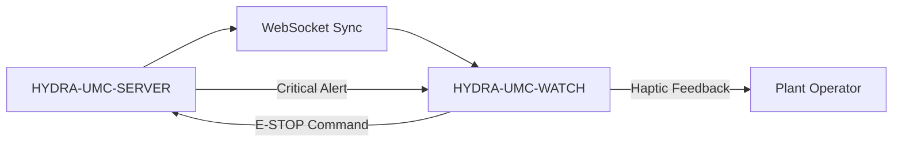

<!-- =============================================================================
HYDRA-UMC-WATCH - Wear OS companion: status cards, haptic alerts and a voice relay
Copyright (C) JuanenRac (Electro Hobby 3D) <electrohobby3d@gmail.com>
GPL-3.0-or-later - see LICENSE
============================================================================= -->

<p align="center">
  
</p>

# ⌚ HYDRA-UMC-WATCH

<p align="center"><a href="README.md">🇺🇸 English</a> | <a href="README_spa.md">🇪🇸 Español</a> | <a href="README_fra.md">🇫🇷 Français</a> | <a href="README_ita.md">🇮🇹 Italiano</a> | <a href="README_deu.md">🇩🇪 Deutsch</a> | <a href="README_zho.md">🇨🇳 简体中文</a> | <a href="README_jpn.md">🇯🇵 日本語</a> | 🇵🇹 <b>Português</b></p>

### ⌚ Companheiro Wear OS: cartões de estado, alertas hápticos e relé de voz (sem E-STOP sem fios)

<p align="center">
  
  
  
  
  
  
</p>

---

> **Estado de segurança (safety e security):** este ecossistema não é um sistema de segurança certificado. Ainda não existe um caminho de E-STOP por hardware, nem limites ou interlocks impostos pelo firmware, nem um comando de movimento verificado; as imagens de firmware são verificadas com CRC32 e um HMAC-SHA256 de chave partilhada, não com uma assinatura assimétrica; TLS e TLS mútuo são opcionais e estão desativados por defeito; nenhuma placa própria foi ainda montada ou testada. Leia a [base de segurança](https://github.com/JuanenRac/HYDRA-UMC-DOCS/blob/main/docs/SECURITY_BASELINE.md) e o [modelo de ameaças](https://github.com/JuanenRac/HYDRA-UMC-DOCS/blob/main/docs/THREAT_MODEL.md) antes de confiar em qualquer afirmação aqui para a segurança de uma pessoa.

---

## 📋 Num relance

| | |
|---|---|
| Versão | `0.2.6` |
| Maturidade | Funcional |
| Testes | 94 (`./gradlew testDebugUnitTest`) |
| Tecnologia | Kotlin / Wear OS |
| Destino | Um relógio Wear OS (emparelhado com o telemóvel) |
| Em hardware real | Ainda não: não há registo de execução em hardware real para esta versão |

**Ir para:** [Visão geral](#-visão-geral) · [Arquitetura](#-arquitetura) · [Segurança e proteção](#-segurança-e-proteção) · [Início rápido](#-início-rápido) · [Testes](#-testes) · [Estrutura do repositório](#-estrutura-do-repositório) · [Projetos relacionados](#-projetos-relacionados)

## 🚦 Estado do projeto

Cada linha é uma parte deste repositório e a luz diz até onde chega hoje. É escrita com o que o repositório consegue demonstrar (testes, compilações, execuções), não com o que está previsto.

🟢 Feito e verificado · 🟡 Funciona, com limites conhecidos · 🟠 Feito a meio ou ainda por verificar · 🔴 Por fazer ou a não funcionar

| Área | Estado | O que significa aqui |
|---|---|---|
| Software | 🟡 | Funciona para o seu propósito principal; a verificação de honestidade acima lista o que ainda falta |
| Testes | 🟢 | 94 testes automáticos, executados a cada alteração |
| Hardware real | 🔴 | Ainda não: não há registo de execução em hardware real para esta versão |
| Documentação | 🟢 | README em oito idiomas, verificado contra o manifesto a cada alteração |

## 🎯 Visão geral

O **HYDRA-UMC-WATCH** é o companheiro de pulso do operador da fábrica. Mostra de relance informação de estado e alertas no pulso e retransmite pequenos turnos de voz através do telemóvel emparelhado. Não é um dispositivo de segurança: não tem E-STOP sem fios e ainda não foi executado num relógio físico.

Construído como uma aplicação Wear OS independente (Kotlin + Jetpack Compose para Wear), reutilizando a mesma cadeia de ferramentas Gradle/Kotlin do repositório irmão HYDRA-UMC-ANDROID-CONTROL em vez de introduzir uma nova.

### Funcionalidades principais:
* ✅ **Real v0 - padrões hápticos e protocolo de sincronização:** `haptics/HapticPatterns.kt` define uma forma de onda de vibração real e distinta por gravidade de alerta (Crítico/Aviso/Informação); `protocol/SyncMessage.kt` define e (des)serializa as formas reais das mensagens `EStopCommand`/`Alert` para o fluxo de sincronização SERVER<->WATCH abaixo. Ambos são Kotlin simples e testável - não é preciso hardware de relógio, emulador nem um WebSocket aberto para executar ou testar nenhum deles.
* 🛑 **E-STOP sem fios (planeado)** — botão de emergência dedicado. *(a mensagem `EStopCommand` que enviaria é real e testada; o transporte WebSocket e a ligação do botão físico continuam planeados - precisam do emparelhamento com o HYDRA-UMC-SERVER.)*
* 📳 **Alertas hápticos** — padrões de vibração diferenciados para vários tipos de alerta (Crítico, Aviso, Informação), reproduzidos através do serviço real `Vibrator`/`VibratorManager` do Android. *(implementado - `haptics/HapticAlertPlayer.kt`; ainda por verificar num dispositivo Wear OS real, tal como o resto desta aplicação.)*
* 🎙️ **Voz** — tocar para falar: pedido explícito da permissão `RECORD_AUDIO`, a intenção de reconhecimento de voz do sistema (`RecognizerIntent`) para a transcrição, a transcrição reencaminhada para o HYDRA-UMC-ANDROID-CONTROL como uma mensagem de sincronização `voice_turn` limitada e uma resposta local por `TextToSpeech` no relógio. *(implementado - `MainActivity.kt`; a voz nunca pode acionar diretamente um robô, veja a Arquitetura abaixo e o [docs/VOICE_AI_PROTOCOL.md](docs/VOICE_AI_PROTOCOL.md) para o fluxo completo de mensagens de ponta a ponta e a fronteira de segurança.)*
* ⌚ **Estado de relance** — um botão **Atualizar estado** reencaminha um pedido de estado limitado para o HYDRA-UMC-ANDROID-CONTROL através da Data Layer emparelhada; o cartão `system_status` devolvido é mostrado com um indicador "último conhecido - pode estar desatualizado" quando fica obsoleto. *(implementado - `MainActivity.kt`/`WatchRelayTransport.requestSystemStatus()`; por pedido através do relé do telemóvel, não um socket de envio direto do relógio para o servidor, e ainda por verificar num dispositivo Wear OS real.)*
* 🔐 **JWT Auth** — emparelhamento com o HYDRA-UMC-SERVER baseado em JWT. *(planeado.)*
* ✅ **Cadeia de ferramentas Wear OS independente** — uma aplicação real Gradle/Kotlin/Compose para Wear que compila um APK de depuração funcional. *(implementado — veja COMPILAR E EXECUTAR abaixo)*
* 🔁 **Política de religação do relé** — `transport/RelayRetryPolicy.kt` é uma política real e pura de recuo exponencial para um envio falhado pelo relé (por exemplo, ainda sem telemóvel emparelhado), limitada a um atraso máximo; uma repetição pendente é cancelada de imediato quando o ecrã se fecha, nunca disparando contra uma atividade já destruída. *(implementado)*
* 🧭 **Seleção de nó verificado pelo companheiro** — o `WatchRelayTransport` envia através de uma consulta real ao `CapabilityClient` (`hydra_umc_phone_companion`, declarada no próprio `res/values/wear.xml` do HYDRA-UMC-ANDROID-CONTROL), nunca por `connectedNodes.firstOrNull()` - um segundo nó ligado sem a aplicação companheira instalada nunca pode ser escolhido por acidente; um nó próximo (alcançável diretamente por Bluetooth) é preferido a um retransmitido pela nuvem quando mais de um se qualifica. *(implementado - `pickCompanionNode()`)*
* 🗂️ **Cache do último estado conhecido** — `transport/LastKnownStateCache.kt` acompanha a desatualização real do último estado/alerta reencaminhado, para que um antigo nunca seja mostrado como atual. *(implementado)*
* 📥 **Caixa do relé** — `transport/RelayInbox.kt`: no Wear OS o ecrã é destruído assim que o pulso é baixado, e uma resposta que chegasse entretanto não tinha recetor e perdia-se. O serviço de escuta guarda agora as mensagens mais recentes (no máximo 8, nenhuma com mais de 10 minutos) e o ecrã mostra-as quando é criado de novo, sem as dizer em voz alta nem vibrar. *(implementado; não testado num relógio real)*
* 🌐 **Interface em 8 idiomas** — `app/src/main/res/values-xx/strings.xml` para inglês, espanhol, francês, alemão, italiano, japonês, chinês e português, escolhido automaticamente a partir do idioma do sistema do relógio; o `LocalizedStringsTest` verifica que cada ficheiro de idioma tem exatamente as chaves e os especificadores de formato do inglês, pelo que uma cadeia em falta ou um marcador partido faz falhar a compilação em vez de aparecer no pulso. *(implementado)*

## 🧩 Papel no HYDRA-UMC

O **HYDRA-UMC-WATCH** é o companheiro Wear OS das aplicações de controlo HYDRA-UMC: mostra o último estado conhecido do sistema com a sua idade, reproduz uma vibração distinta para cada gravidade de alerta e reencaminha um pedido de voz através do telemóvel emparelhado. Não guarda nenhuma credencial do servidor e não oferece paragem de emergência sem fios.

## 🏛️ Arquitetura

<p align="center">
  
</p>

<details>
<summary>Versão em texto do diagrama (Mermaid)</summary>



</details>

### FLUXO DE SINCRONIZAÇÃO DO DISPOSITIVO VESTÍVEL

*Arquitetura de destino quando existir um WebSocket direto com o Servidor. O caminho real e testado hoje
reencaminha antes através do telemóvel emparelhado: Relógio -> Data Layer ->
HYDRA-UMC-ANDROID-CONTROL -> HYDRA-UMC-SERVER/Voice UI autenticado, e de
volta - veja a Arquitetura abaixo e o
[docs/VOICE_AI_PROTOCOL.md](docs/VOICE_AI_PROTOCOL.md) para esse fluxo real
de ponta a ponta. O Relógio nunca guarda ele próprio uma credencial do Servidor; um WebSocket
direto Relógio-Servidor e o botão de E-STOP sem fios continuam a ser trabalho
futuro, dependente de hardware.*

### ARQUITETURA E DECISÕES DE DESENHO

* **Porque é uma aplicação Wear OS independente e não uma funcionalidade da aplicação do telemóvel.** Um relógio corre o seu próprio processo independente no seu próprio sistema operativo - não pode ser simplesmente um modo de interface do HYDRA-UMC-ANDROID-CONTROL, precisa do seu próprio manifesto, da sua própria compilação e da sua própria interface (muito mais limitada) para o estado de relance/E-STOP rápido.
* **Porque `minSdk 30` (Wear OS 3), inferior ao minSdk da própria aplicação do telemóvel.** Isto visa deliberadamente a geração atual de hardware Wear OS 3+, não dispositivos antigos com Wear OS 2 - ao contrário do HYDRA-UMC-ANDROID-CONTROL, que suporta telemóveis mais antigos, uma aplicação de relógio companheira tem uma base de hardware realista mais estreita para suportar.
* **Porque o relé emparelhado usa a Data Layer em vez de um socket próprio.** O canal oficial do Wear OS impõe o mesmo nome de pacote e o mesmo certificado de assinatura no Relógio e no telemóvel, e transporta apenas mensagens de protocolo limitadas. O Android Control mantém a sessão do Servidor; isto mantém o Relógio fora dos caminhos diretos de credenciais do Servidor e de controlo de robôs.
* **Porque a política de religação e a cache do último estado conhecido são módulos puros próprios, e não código dentro do `WatchRelayTransport`.** Ambos são classes Kotlin reais e desacopladas (`RelayRetryPolicy`, `LastKnownStateCache`), testáveis numa JVM simples sem relógio, emulador nem telemóvel emparelhado - o mesmo padrão que `HapticPatterns.kt`/`SyncMessage.kt` já definiram. O próprio `WatchRelayTransport` continua a ser a peça fina, necessariamente Android, que de facto agenda uma repetição ou regista uma mensagem recebida, e não o local onde vive a matemática da política.
* **Porque um estado em cache desatualizado é assinalado e não escondido.** Retirar por completo um estado antigo deixaria o mostrador do relógio em branco precisamente quando a ligação ao telemóvel é instável - o momento de risco real. Mostrá-lo claramente marcado como "último conhecido - pode estar desatualizado" mantém o operador informado sem deixar que uma leitura com minutos passe por uma em direto.
* **Como isto se encaixa no resto do ecossistema.** Emparelha com o HYDRA-UMC-ANDROID-CONTROL e o HYDRA-UMC-IOS-CONTROL como um companheiro de pulso de relance - não um substituto de nenhum deles, mas uma superfície de estado rápido/E-STOP rápido.

### ATUALIZAÇÕES SEM GOOGLE PLAY

Este projeto não é distribuído através da Google Play. O caminho de atualização
repetível é um APK de uma Release do GitHub instalado por ADB:

```bash
# a partir da raiz do projeto, com o relógio emparelhado e a depuração sem fios ativada
update-from-github.bat    # Windows
./update-from-github.sh   # Linux / macOS / WSL
```

O script lê o `releases/latest` do GitHub, exige uma etiqueta estável
`vMAJOR.MINOR.PATCH`, verifica a versão já instalada, pede confirmação
explícita ao operador e depois descarrega e executa `adb install -r`. Nunca
toca na versão do repositório, no manifesto nem no `CHANGELOG.md`. Também está documentada
uma instalação manual, no melhor esforço (abrir diretamente o instalador de pacotes
do APK descarregado no relógio) para dispositivos sem um caminho ADB utilizável. Veja
[docs/GITHUB_ADB_UPDATES.md](docs/GITHUB_ADB_UPDATES.md) para o procedimento completo,
o requisito de nomenclatura do APK de release e a configuração de assinatura de versões.

O `HYDRA-UMC-ANDROID-CONTROL` pode informar o operador de que existe uma
versão mais recente do Relógio assim que a mensagem de estado de versão do companheiro
emparelhado estiver ligada — é meramente informativo e nunca pode instalar nada no
próprio relógio. Veja [docs/COMPANION_VERSION_PROTOCOL.md](docs/COMPANION_VERSION_PROTOCOL.md)
para a forma dessa mensagem.

## 🔒 Segurança e proteção

| Ameaça | Defesa | Onde |
|---|---|---|
| Outra aplicação ou o telemóvel de um desconhecido a enviar mensagens ao relógio | O reencaminhamento usa a Data Layer do Wear OS, que só transporta tráfego entre APK com o mesmo nome de pacote e certificado de assinatura; o destino escolhe-se por uma consulta de capacidade, nunca adivinhando um nó ligado | `WatchRelayTransport.kt` |
| Um relógio roubado ou perdido que dá acesso ao servidor | O relógio nunca guarda uma credencial do servidor: a aplicação do telemóvel emparelhado autentica-se e o relógio só reencaminha mensagens de protocolo limitadas | `SyncMessage.kt`, `docs/VOICE_AI_PROTOCOL.md` |
| Uma ação oferecida quando o telemóvel está fora de alcance, e que depois falha | Sem uma mensagem recente do telemóvel companheiro, uma ação que passa por ele fica retida; uma atualização nunca é bloqueada, porque é assim que se obtém o sinal de vida, e um estado antigo mostra-se marcado como antigo, não escondido | `CriticalActionGate.kt`, `LastKnownStateCache.kt` |

**O que nunca faz:** servir de paragem de emergência. Um botão de paragem de emergência sem fios e uma ligação direta ao servidor são trabalho futuro que precisa de hardware.

## 🚀 Início rápido

Requer o SDK do Android com um JDK que o wrapper do Gradle incluído aceite, e um relógio ou emulador com Wear OS 3 ou superior.

```bash
./build.sh               # Linux, macOS (build.bat on Windows)
./run.sh                 # installs the debug app on the connected watch and starts it
./update-from-github.sh  # installs the newest release by ADB, without Google Play
```

## 🧪 Testes

94 testes automáticos correm com `./gradlew testDebugUnitTest`. Não precisam de hardware nem de nada fora desta máquina.

A CI executa `HYDRA_UMC_CI=1 python tools/ci_validate.py`, que verifica o manifesto, os documentos, os oito README e as imagens.

## 🏗️ Compilação e publicação

Requer o JDK 21, o SDK do Android (`local.properties` → `sdk.dir`, ignorado pelo git — aponte-o para a sua própria instalação do SDK) e um dispositivo ou emulador Wear OS para o `run`.

```bash
# Linux/macOS
chmod +x gradlew   # uma só vez
./build.sh
./run.sh            # precisa de um dispositivo/emulador Wear OS ligado

# Windows
build.bat
run.bat
```

O `build` nunca altera a versão (só `python tools/hydra_project_tool.py bump` a sobe), executa a verdadeira suite de testes JUnit (`haptics`, `protocol`, `transport`) e compila o APK de depuração para `app/build/outputs/apk/debug/app-debug.apk` - tudo numa única invocação do Gradle (os scripts ainda passam `-PhydraUmcReadOnly=true`, mas já não tem efeito: a compilação do Gradle nunca altera a versão). O `run` instala o APK com `gradlew installDebug` e lança a `MainActivity` com o `adb`.

Exemplo real - os dois scripts de subida de versão são executados pelo comando `bump` explícito e também correm isolados (alteram os ficheiros de versão quando correm):

```bash
python3 bump_manifest_version.py   # por exemplo "HYDRA-UMC version: v0.1.2 -> v0.1.3"
python3 bump_version_code.py       # por exemplo "versionCode: 12 -> 13"
```

## 📂 Estrutura do repositório

<p align="center">
  
</p>

<details>
<summary>Versão em texto da árvore</summary>

```text
HYDRA-UMC-WATCH/
├── tools/                                código-fonte
│   ├── build_test.py                     Verificação de CI sem alterações: verificação de contrato + assembleDebug
│   ├── ci_validate.py                    Validação de manifesto/CHANGELOG/documentação usada pelo CI
│   ├── verify_paired_relay_contract.py   Verificação estática da fronteira de segurança da Data Layer Relógio<->Android Control
│   ├── _doc_policy.py                    Regras de documentação partilhadas pela família (cópia da de HYDRA-UMC-SDK, mantida em sincronia)
│   ├── _readme_parity.py                 Verificação de que os oito README partilham a mesma estrutura (cópia da de HYDRA-UMC-SDK, mantida em sincronia)
│   ├── hydra_project_tool.py             Os mesmos comandos em todos os repositórios: validate, test, ci, version, status, bump
│   └── extra_build_steps.py              Os passos de compilação próprios deste repositório além do teste de compilação partilhado (os seus testes unitários)
├── app/
├── gradle/
├── docs/                                 Documentação e protocolos de segurança
├── images/                               Multimédia e diagramas
├── .github/                              fluxo de CI e modelos de problemas
├── build.gradle.kts                      Compilação Gradle raiz
├── settings.gradle.kts                   Ligação dos módulos
├── gradlew / gradlew.bat                 Lançador do Gradle wrapper
├── hydra-umc.project.json                Manifesto do ecossistema (versão, metadados de compilação/saúde)
├── keystore.properties.example           Modelo da configuração de assinatura de versões, ignorada pelo git
├── bump_manifest_version.py              Sobe major/minor/patch + o manifesto, em conjunto
├── bump_version_code.py                  Subida do contador versionCode do Android (executada só pelo comando `bump` explícito)
├── build.sh / build.bat                  Compilação real: executa os testes, assembleDebug
├── build-test.sh / build-test.bat        Invólucro sem alterações para tools/build_test.py
├── run.sh / run.bat                      Execução real: gradlew installDebug + arranque por adb
├── CHANGELOG.md                          o que mudou em cada versão
├── test.sh                               executa os testes
├── update-from-github.bat                instala a versão mais recente por ADB
└── update-from-github.sh                 instala a versão mais recente por ADB
```

</details>

## 🗺️ Roteiro e limites conhecidos

**Limites conhecidos hoje**

**Real hoje:** reprodução local de alertas através do serviço `Vibrator` do Android, permissão explícita do microfone e reconhecimento de voz do sistema, retorno visível da transcrição e texto para fala local, além de mensagens tipadas e testadas para `voice_turn`, `assistant_reply`, `system_status`, `EStopCommand`, `Alert` e o estado de versão do companheiro. A Data Layer oficial do Wear OS reencaminha turnos de voz limitados e pedidos de cartão de estado através do HYDRA-UMC-ANDROID-CONTROL para o Servidor autenticado e o Voice UI.

**Fronteira de integração:** a aplicação Android emparelhada mantém o JWT cifrado do Servidor; o Servidor mantém o token do Voice UI. A Data Layer exige o mesmo nome de pacote e o mesmo certificado de assinatura nos dois APKs. A voz nunca pode acionar diretamente um robô; uma resposta relacionada com movimento tem de exigir confirmação, enquanto o E-STOP físico continua independente.

**Ainda por fazer:** validação do emparelhamento, do transporte de rádio, do microfone/altifalante e do estado de ponta a ponta num dispositivo Wear OS real; o E-STOP sem fios e a telemetria em direto do CM5 continuam a ser trabalho separado, dependente de hardware.

## 🌍 Idiomas

Este README e os documentos do repositório existem em oito idiomas: inglês, espanhol, alemão, francês, italiano, japonês, chinês e português (Portugal). São escritos em conjunto e a CI verifica que os oito ficheiros têm as mesmas secções e as mesmas ligações.

## 🔗 Projetos relacionados

Este projeto faz parte do ecossistema de robótica HYDRA-UMC do mesmo autor (JuanenRac / Electro Hobby 3D). Vale a pena conhecê-los, porque um pedido pode ser, na verdade, sobre um destes e não sobre este repositório.

**Diretamente relacionados**
- **[HYDRA-UMC-ANDROID-CONTROL](https://github.com/JuanenRac/HYDRA-UMC-ANDROID-CONTROL)** — aplicação Android nativa de controlo, com início de sessão biométrico e um companheiro Wear OS emparelhado — a aplicação companheira com que este dispositivo vestível se emparelha.
- **[HYDRA-UMC-IOS-CONTROL](https://github.com/JuanenRac/HYDRA-UMC-IOS-CONTROL)** — aplicação de controlo para iOS/iPadOS (Flutter) com sincronização WebSocket em tempo real — a aplicação companheira com que este dispositivo vestível se emparelha.
- **[HYDRA-UMC-VOICE-UI](https://github.com/JuanenRac/HYDRA-UMC-VOICE-UI)** — front-end de voz real (VAD + analisador de intenções) com um relé para o relógio limitado e protegido por confirmação — envia as mensagens voice_turn que este dispositivo vestível apresenta como alertas hápticos.

**Também fazem parte do ecossistema**

*Hardware e plataforma centrais*
- **[HYDRA-UMC](https://github.com/JuanenRac/HYDRA-UMC)** — o desenho da placa-mãe do braço robótico: anfitrião CM5 + STM32H745 de dois núcleos, pensado para orquestrar até 8 braços de ferramenta por CAN-OTA/SPI-OTA (firmware numa fase inicial; ainda sem placa montada).
- **[HYDRA-UMC-OS](https://github.com/JuanenRac/HYDRA-UMC-OS)** — camada de produto reproduzível do Raspberry Pi OS para o CM5: agente só de leitura, configuração/perfis validados, aprovisionamento Wi-Fi de primeiro contacto.
- **[HYDRA-UMC-SDK](https://github.com/JuanenRac/HYDRA-UMC-SDK)** — o contrato JSON-Schema partilhado e a fronteira de software de controlo de trabalhos contra a qual cada bridge valida os seus comandos (não é uma função de segurança certificada).
- **[HYDRA-UMC-CONNECTOR-HUB](https://github.com/JuanenRac/HYDRA-UMC-CONNECTOR-HUB)** — registo declarativo de manifestos de adaptador e validador para conectores de máquinas externas; estende a ideia de contrato do SDK a máquinas externas sem substituir os projetos de gateway industrial.

*Backend central e clientes*
- **[HYDRA-UMC-SERVER](https://github.com/JuanenRac/HYDRA-UMC-SERVER)** — o back-end headless real (REST/WebSocket) com que todos os clientes de controlo realmente comunicam.
- **[HYDRA-UMC-STUDIO](https://github.com/JuanenRac/HYDRA-UMC-STUDIO)** — painel web de controlo com visualização 3D em tempo real de vários robôs.
- **[HYDRA-UMC-SUITE](https://github.com/JuanenRac/HYDRA-UMC-SUITE)** — centro de comando de enxame para desktop (PySide6) para vários servidores ao mesmo tempo, empacotado como executável independente.
- **[HYDRA-UMC-DSI](https://github.com/JuanenRac/HYDRA-UMC-DSI)** — interface tátil nativa para o ecrã tátil DSI de 7" integrado, executada no próprio CM5.
- **[HYDRA-UMC-EDITOR-URDF](https://github.com/JuanenRac/HYDRA-UMC-EDITOR-URDF)** — criador/editor gráfico de URDF para desktop que envia os modelos concluídos para o catálogo do STUDIO.
- **[HYDRA-UMC-EDITOR-STL](https://github.com/JuanenRac/HYDRA-UMC-EDITOR-STL)** — editor de modelos STL para desktop que transforma/substitui/remove/adiciona peças reais no mesmo catálogo de modelos que o HYDRA-UMC-EDITOR-URDF também edita.
- **[HYDRA-UMC-BRIDGE-AMR](https://github.com/JuanenRac/HYDRA-UMC-BRIDGE-AMR)** — fronteira de coordenação para frotas AGV/AMR através de um publicador MQTT VDA 5050 (testado apenas contra uma frota emulada).
- **[HYDRA-UMC-BRIDGE-CNC](https://github.com/JuanenRac/HYDRA-UMC-BRIDGE-CNC)** — coordenador de células CNC de alto nível com acesso ao estado GRBL e aos bytes de controlo (testado apenas contra um emulador).
- **[HYDRA-UMC-BRIDGE-DROIDS](https://github.com/JuanenRac/HYDRA-UMC-BRIDGE-DROIDS)** — fronteira de coordenação para droides com patas/humanoides, com um emissor de comandos para o Boston Dynamics Spot (testado apenas contra um emulador).
- **[HYDRA-UMC-BRIDGE-LASER](https://github.com/JuanenRac/HYDRA-UMC-BRIDGE-LASER)** — coordenador de células laser que lê 3 sinais GPIO (chave, caixa e interlock) (testado apenas contra um chip simulado; não pode armar nem disparar um laser).
- **[HYDRA-UMC-BRIDGE-OPENPNP](https://github.com/JuanenRac/HYDRA-UMC-BRIDGE-OPENPNP)** — coordenador seguro de fluxo de placa de alto nível para pick-and-place com OpenPnP.
- **[HYDRA-UMC-BRIDGE-PRINTER3D](https://github.com/JuanenRac/HYDRA-UMC-BRIDGE-PRINTER3D)** — fronteira de coordenação segura para impressoras 3D Moonraker/Klipper, com comandos de trabalho reais protegidos por portas.
- **[HYDRA-UMC-BRIDGE-ROS2](https://github.com/JuanenRac/HYDRA-UMC-BRIDGE-ROS2)** — coordenador com um transporte ROS 2 baseado em rclpy importado sob demanda (ainda não executado contra uma instalação ROS 2).
- **[HYDRA-UMC-BRIDGE-UAV](https://github.com/JuanenRac/HYDRA-UMC-BRIDGE-UAV)** — fronteira de coordenação para UAV com câmara, com um emissor de comandos MAVLink (testado apenas contra um emulador).

*Plataforma de ferramentas URTC*
- **[URTC](https://github.com/JuanenRac/URTC)** — firmware da placa física Universal Robot Tool Controller, mais de 25 perfis de ferramenta por barramento CAN.
- **[URTC-FLASHER](https://github.com/JuanenRac/URTC-FLASHER)** — ferramenta gráfica de gravação para desktop das placas URTC, por CAN-OTA e também SWD/JTAG de chip completo.
- **[URTC-TESTER](https://github.com/JuanenRac/URTC-TESTER)** — ferramenta de diagnóstico CAN em tempo real para desktop das placas URTC, com um painel por perfil de ferramenta.
- **[URTC-WEB-STUDIO](https://github.com/JuanenRac/URTC-WEB-STUDIO)** — alternativa no navegador ao URTC-TESTER através da Web Serial API, sem instalação local.
- **[URTC-GATEWAY](https://github.com/JuanenRac/URTC-GATEWAY)** — gateway à frente do barramento CAN do URTC: lista de identificadores permitidos, limite de taxa e chave de sessão; software testado num computador, ainda não num barramento real.

*Nó de IA de visão (Hailo-8)*
- **[HYDRA-UMC-VISION-NODE](https://github.com/JuanenRac/HYDRA-UMC-VISION-NODE)** — centro de integração do pipeline de visão Hailo-8, com uma verificação real de prontidão de hardware por fase.
- **[HYDRA-UMC-DETECTION-HEF](https://github.com/JuanenRac/HYDRA-UMC-DETECTION-HEF)** — registo real de modelos compilados com verificação segura de carga por arquitetura Hailo e soma de verificação.
- **[HYDRA-UMC-VISION-STREAMER](https://github.com/JuanenRac/HYDRA-UMC-VISION-STREAMER)** — pipeline GStreamer real e gerador de configuração MediaMTX com uma fronteira de integração HailoRT real.
- **[HYDRA-UMC-VISUAL-SERVOING-API](https://github.com/JuanenRac/HYDRA-UMC-VISUAL-SERVOING-API)** — lei de correção de servovisão baseada em posição com autorização condicionada ao estado da zona; ainda sem estimativa de pose por câmara.
- **[HYDRA-UMC-SAFETY-ZONES](https://github.com/JuanenRac/HYDRA-UMC-SAFETY-ZONES)** — lógica v0 de violação de zonas, atualidade da calibração e pedido de E-STOP que lê as posições dos objetos de um ficheiro; nenhum detetor a alimenta e ainda não há E-STOP físico ligado.

*Nó de IA cognitiva (Hailo-10)*
- **[HYDRA-UMC-COGNITIVE-NODE](https://github.com/JuanenRac/HYDRA-UMC-COGNITIVE-NODE)** — centro de integração do pipeline cognitivo do Hailo-10 (orquestração de LLM/VLA/voz).
- **[HYDRA-UMC-VLA-ENGINE](https://github.com/JuanenRac/HYDRA-UMC-VLA-ENGINE)** — codificação/descodificação real de tokens de ação e geração de trajetórias para um modelo Visão-Linguagem-Ação.
- **[HYDRA-UMC-SEMANTIC-PLANNER](https://github.com/JuanenRac/HYDRA-UMC-SEMANTIC-PLANNER)** — decomposição real de tarefas baseada em regras e recuperação semântica de erros sobre os códigos de erro do MCU.
- **[HYDRA-UMC-DOCS-QA](https://github.com/JuanenRac/HYDRA-UMC-DOCS-QA)** — pesquisa real de documentos TF-IDF só com a biblioteca padrão sobre a documentação Markdown deste ecossistema.
- **[HYDRA-UMC-LOCAL-TECHNICIAN](https://github.com/JuanenRac/HYDRA-UMC-LOCAL-TECHNICIAN)** — técnico de manutenção de IA local, protegido por políticas, para o próprio ecossistema: observa, diagnostica e propõe correções; os dois níveis de maior risco não estão implementados de propósito.

*Orquestração e enxame*
- **[HYDRA-UMC-ORCHESTRATOR](https://github.com/JuanenRac/HYDRA-UMC-ORCHESTRATOR)** — centro de integração com um contrato real de relatório de saúde gRPC/Protobuf e uma máquina de estados de missões.
- **[HYDRA-UMC-JOB-DISPATCHER](https://github.com/JuanenRac/HYDRA-UMC-JOB-DISPATCHER)** — fila real de trabalhos por prioridade com deduplicação, sobre uma API HTTP real.
- **[HYDRA-UMC-NODE-HEALING](https://github.com/JuanenRac/HYDRA-UMC-NODE-HEALING)** — vigilante real de saúde da frota por gRPC com repetição/recuo e deteção de identidade incoerente.
- **[HYDRA-UMC-PATH-PLANNER-3D](https://github.com/JuanenRac/HYDRA-UMC-PATH-PLANNER-3D)** — planeador real de trajetórias 3D baseado em RRT com validação real de colisões com obstáculos e espaço de trabalho.
- **[HYDRA-UMC-SWARM-SYNC](https://github.com/JuanenRac/HYDRA-UMC-SWARM-SYNC)** — sincronização real de estado CRDT LWW-Element-Map, testada por propriedades para a convergência de várias células.

*Gémeo digital e simulação*
- **[HYDRA-UMC-TWIN](https://github.com/JuanenRac/HYDRA-UMC-TWIN)** — centro de integração do motor de gémeo digital, com um contrato real de sincronização de compatibilidade de versões.
- **[HYDRA-UMC-HIL-BRIDGE](https://github.com/JuanenRac/HYDRA-UMC-HIL-BRIDGE)** — encaminhador hardware-in-the-loop com um interlock de software de colisão entre a simulação e o hardware real (testado sem hardware real).
- **[HYDRA-UMC-PHYSICS-REPLICA](https://github.com/JuanenRac/HYDRA-UMC-PHYSICS-REPLICA)** — cinemática direta real e validação de limites de juntas sobre um subconjunto real de URDF.
- **[HYDRA-UMC-SYNTHETIC-DATA-GEN](https://github.com/JuanenRac/HYDRA-UMC-SYNTHETIC-DATA-GEN)** — gerador procedural real de cenas 2D com exportação de anotações YOLO/COCO.

*Dados e análise*
- **[HYDRA-UMC-DATALAKE](https://github.com/JuanenRac/HYDRA-UMC-DATALAKE)** — armazém real de séries temporais sobre sqlite3 com uma API HTTP real de ingestão/consulta.
- **[HYDRA-UMC-ANOMALY-DETECTOR](https://github.com/JuanenRac/HYDRA-UMC-ANOMALY-DETECTOR)** — detetor real de anomalias por FFT e linha de base estatística, com monitorização de deriva.
- **[HYDRA-UMC-PRODUCTION-REPORTS](https://github.com/JuanenRac/HYDRA-UMC-PRODUCTION-REPORTS)** — cálculo real de OEE/disponibilidade sobre o histórico do DATALAKE, com exportação CSV reprodutível.
- **[HYDRA-UMC-TELEMETRY-COLLECTOR](https://github.com/JuanenRac/HYDRA-UMC-TELEMETRY-COLLECTOR)** — pipeline real de ingestão CAN/WebSocket para o DATALAKE, com deduplicação por sequência.

*Gateway industrial*
- **[HYDRA-UMC-GATEWAY-INDUSTRIAL](https://github.com/JuanenRac/HYDRA-UMC-GATEWAY-INDUSTRIAL)** — centro de integração que retransmite para protocolos industriais, com uma camada real de lista de comandos permitidos e contrapressão.
- **[HYDRA-UMC-OPCUA-SERVER](https://github.com/JuanenRac/HYDRA-UMC-OPCUA-SERVER)** — espaço de endereços OPC-UA real, verificado com uma sessão de cliente real do protocolo binário.
- **[HYDRA-UMC-MQTT-BROKER](https://github.com/JuanenRac/HYDRA-UMC-MQTT-BROKER)** — broker MQTT real com autenticação opcional por cliente e ACL de tópicos.
- **[HYDRA-UMC-MTCONNECT-ADAPTER](https://github.com/JuanenRac/HYDRA-UMC-MTCONNECT-ADAPTER)** — endpoints XML MTConnect `/probe` e `/current` reais com saída em modo degradado.

*Ferramentas complementares e operações do ecossistema*
- **[HYDRA-UMC-DASHBOARD-AI](https://github.com/JuanenRac/HYDRA-UMC-DASHBOARD-AI)** — painéis de Resumos Inteligentes e Realce de Anomalias sobre o DATALAKE/ANOMALY-DETECTOR, com um recurso estatístico honesto.
- **[HYDRA-UMC-TOOL-CLI](https://github.com/JuanenRac/HYDRA-UMC-TOOL-CLI)** — CLI da frota com um contrato de códigos de saída real e estável, um cliente vivo genuíno da API do HYDRA-UMC-SERVER.
- **[URTC-SMART-RACK](https://github.com/JuanenRac/URTC-SMART-RACK)** — firmware de um rack de montagem de placas com descodificação real do ID da ferramenta e lógica de pré-aquecimento Smart Idle.
- **[URTC-VISION-TOOL](https://github.com/JuanenRac/URTC-VISION-TOOL)** — firmware mais um companheiro de visão em Python real para uma cabeça de ferramenta de inspeção térmica/RGB.
- **[HYDRA-UMC-UPDATER](https://github.com/JuanenRac/HYDRA-UMC-UPDATER)** — ferramenta administrativa de desktop que descobre, clona e atualiza todos os repositórios deste ecossistema.
- **[HYDRA-UMC-OS-REBUILDER](https://github.com/JuanenRac/HYDRA-UMC-OS-REBUILDER)** — ferramenta de desktop para Windows/Linux que constrói uma imagem do CM5 pronta a gravar com as versões mais recentes do ecossistema, com configuração de primeiro arranque de Wi-Fi/utilizador/SSH ao estilo do Raspberry Pi Imager.
- **[HYDRA-UMC-OPS-AGENT](https://github.com/JuanenRac/HYDRA-UMC-OPS-AGENT)** — coordenador de incidentes de manutenção: um papel de borda de poucos privilégios recolhe um inventário/estado higienizado, um papel de plano de controlo mostra-o só de leitura e pede a um fornecedor de IA que sugira um diagnóstico; nunca aplica um patch nem implanta nada.
- **[HYDRA-UMC-DEV-SERVER](https://github.com/JuanenRac/HYDRA-UMC-DEV-SERVER)** — anfitrião de desenvolvimento reproduzível (Raspberry Pi 5 / CM5) que guarda o código-fonte do ecossistema e executa tarefas limitadas de compilação/teste numa fila durável; um papel de desenvolvimento dedicado, explicitamente não um CM5 operacional.

## 📚 Documentação

Onde ler mais:

* [Base de segurança do ecossistema](https://github.com/JuanenRac/HYDRA-UMC-DOCS/blob/main/docs/SECURITY_BASELINE.md)
* [Modelo de ameaças do ecossistema](https://github.com/JuanenRac/HYDRA-UMC-DOCS/blob/main/docs/THREAT_MODEL.md)
* [Registo de alterações deste repositório](CHANGELOG.md)
* [Licença deste repositório](LICENSE.md)

## 🤝 Contribuir e comunidade

* Antes de um pull request execute `HYDRA_UMC_CI=1 py -3 tools/ci_validate.py` (ou `HYDRA_UMC_CI=1 python3 tools/ci_validate.py`): tem de imprimir `CI_VALIDATION=PASS`. Não execute `build.sh` nem `build.bat` para esta verificação; compilar não é verificar.
* Os oito README são escritos a partir de uma única fonte em HYDRA-UMC-DOCS; não os edite à mão. Altere a fonte e escreva-os de novo com `tools/make_readmes.py`.
* Não afirme num README o que não foi executado: diga «simulado» ou «não testado em hardware» quando for a verdade.
* Consulte [CONTRIBUTING.md](CONTRIBUTING.md), o [código de conduta](CODE_OF_CONDUCT.md), [SECURITY.md](SECURITY.md) e [SUPPORT.md](SUPPORT.md).

## 👤 AUTOR

**JuanenRac (Electro Hobby 3D)** · electrohobby3d@gmail.com

## 📜 LICENÇA

GPL-3.0-or-later - [LICENSE](LICENSE).
